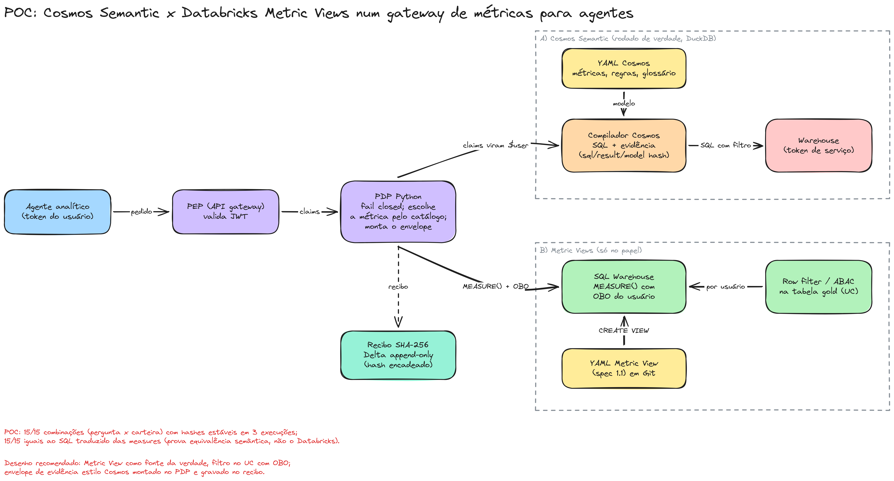

# Cosmos Semantic x Databricks Metric Views: POC

POC que compara duas formas de expor métricas governadas a agentes de IA:

- **[Cosmos Semantic](https://github.com/WiliamRosa/cosmos-semantic-platform)** (open source, Apache-2.0), **executado de verdade** contra DuckDB com dados sintéticos;
- **Databricks Metric Views** (Unity Catalog), **só no papel**: a definição está escrita e conferida na documentação, mas nada foi executado num workspace Databricks.

**Contexto (genérico):** uma empresa regulada que expõe métricas analíticas a agentes por um gateway com PEP (API gateway que valida o JWT), PDP stateless que decide e falha fechado, recibo SHA-256 por resposta em tabela append-only e direitos de acesso num catálogo governado. A pergunta: qual camada semântica colocar atrás desse gateway para que a mesma pergunta sempre vire a mesma métrica, com evidência auditável?

As mesmas 7 métricas (clientes ativos 90 dias, receita bruta, reembolsos efetivados, receita líquida, pedidos pagos, ticket médio e taxa de reembolso) foram definidas nos dois lados. A equivalência é checada traduzindo as measures da Metric View para SQL puro no mesmo DuckDB. Isso prova que as definições são semanticamente iguais; **não prova** o comportamento do Databricks (veja a seção 8).

## Resultado em uma tela

- **15 de 15** combinações (5 perguntas x 3 carteiras) com `sql_hash`, `result_hash` e `model_hash` idênticos em 3 execuções.
- **15 de 15** iguais ao SQL traduzido das measures da Metric View.
- **Fail closed:** sem o claim `carteira`, a consulta é negada. Agente pedindo CNPJ é negado; a mesma consulta fora do canal de agente passa (o bloqueio do Cosmos depende do canal).
- **Replay:** distingue `identical` de `data_changed` (1 reembolso a mais muda só o `result_hash`).
- **Achado:** `net_revenue` escrito como `bruta - reembolsos` sai NULL em dias sem reembolso; corrigido com `COALESCE` (seção 4).
- **Recomendação:** Metric View como fonte da verdade (filtro no UC, consulta com OBO); envelope de evidência e replay no estilo Cosmos montados no PDP e gravados no recibo. A escolha da métrica deve ficar no PDP, pelo catálogo, e não no LLM.



Relatório completo: [docs/relatorio.md](docs/relatorio.md). Diagrama editável: [docs/diagrama.excalidraw](docs/diagrama.excalidraw).

*Dados 100% sintéticos (seed 42): nomes "Empresa 0001…", CNPJs com dígitos aleatórios e sem dígito verificador válido. Não há segredos nem dados pessoais.*

## 1. Pré-requisitos

| Item | Versão usada |
|---|---|
| SO | Linux ou macOS (no Windows, use WSL) |
| Python | 3.12 (o Cosmos exige 3.11 ou mais) |
| git | qualquer versão recente |
| Cosmos Semantic | `WiliamRosa/cosmos-semantic-platform`, commit `12e458fb5f3788361926b805b4bb3b43bda64beb` (release 0.5.0, de 23/11/2026; não tem tag git, use o commit) |
| sqlglot | 30.24.0 (o `sql_hash` depende do SQL gerado, então fixe a versão) |
| duckdb | 2.0.0 |
| pyarrow | 26.0.0 |
| pydantic / pyyaml / typer | 2.14.1 / 6.0.3 / 0.27.3 |

Acesso necessário: `github.com` e `pypi.org`. Não precisa de Docker, Databricks, chave de LLM nem base de dados externa.

## 2. Ambiente

```bash
git clone https://github.com/glopes-boop/pocs.git
cd pocs/cosmos-semantic-vs-metric-views
python3.12 -m venv .venv          # sem python3.12? use: uv venv -p 3.12 --seed .venv
source .venv/bin/activate
python -m pip install --upgrade pip
pip install -r requirements.txt   # Cosmos no commit exato + versões fixadas (sqlglot afeta o sql_hash)
cosmos --help | head -5           # deve listar os comandos (query, replay, validate...)
```

O código do Cosmos **não** está neste repositório; ele é instalado do repositório original no commit `12e458f`. Para ler o código:

```bash
git clone https://github.com/WiliamRosa/cosmos-semantic-platform.git
git -C cosmos-semantic-platform checkout 12e458fb5f3788361926b805b4bb3b43bda64beb
```

## 3. Estrutura

```
cosmos-semantic-vs-metric-views/
  README.md
  LICENSE                          MIT (este repositório; o Cosmos é Apache-2.0)
  requirements.txt                 dependências fixadas
  docs/relatorio.md                relatório completo da comparação
  docs/diagrama.png|.excalidraw    diagrama (gerado por scripts/diagrama_cosmos_vs_mv.py)
  scripts/gerar_dados.py           dados sintéticos determinísticos (seed 42) -> data/vendas.duckdb
  scripts/rodar_poc.py             roda o Cosmos 3x por pergunta e carteira, negações, replay e equivalência
  scripts/diagrama_cosmos_vs_mv.py, excalidraw_lib.py, render.mjs   geração do diagrama
  cosmos/connections.yml           fonte DuckDB
  cosmos/semantic/modelo.yml       modelos, métricas e row filter por carteira
  cosmos/semantic/ontologia.yml    glossário e regras de negócio versionadas, com testes
  metric-views/fct_pedidos.sql     tabela gold de origem (usada também na checagem de equivalência)
  metric-views/mv_pedidos.sql      CREATE VIEW ... WITH METRICS (só no papel)
  metric-views/consultas_measure.sql  consultas MEASURE() equivalentes
  metric-views/governanca_uc.sql   GRANT, row filter, máscara e auditoria no UC (só no papel)
  results/                         saídas da execução de referência (JSON, SQL, TXT, audit JSONL)
  data/                            gerado localmente (vendas.duckdb, ignorado pelo git)
```

## 4. Achado: patch do COALESCE em `net_revenue`

Já aplicado em `cosmos/semantic/modelo.yml`. Escrita do jeito óbvio, a receita líquida sai **NULL** nos grupos sem reembolso efetivado, porque o SQL gerado faz `item_total - refund_value` e `refund_value` vem NULL:

```diff
   - name: net_revenue
     type: derived
     owner: controladoria
-    expr: "{gross_revenue} - {refunds_completed}"
+    expr: "{gross_revenue} - COALESCE({refunds_completed}, 0)"
```

Como ver a diferença: carteira Corporate, por dia, a partir de 25/10/2026.

```bash
cd cosmos
cosmos query gross_revenue refunds_completed net_revenue --by orders.ordered_at__day \
  --where "{orders.ordered_at} >= DATE '2026-10-25'" --order orders.ordered_at__day \
  --as-of 2026-10-31 -u carteira=Corporate -m semantic -c connections.yml
cd ..
```

| Dia | Bruta | Reembolsos | Líquida **antes** | Líquida **depois** |
|---|---|---|---|---|
| 2026-10-26 | 41.451,68 | — | (vazio) | 41.451,68 |
| 2026-10-27 | 5.577,89 | 1.673,37 | 3.904,52 | 3.904,52 |
| 2026-10-28 | 93.908,60 | 7.359,29 | 86.549,31 | 86.549,31 |
| 2026-10-29 | 53.911,71 | — | (vazio) | 53.911,71 |
| 2026-10-30 | 108.744,33 | — | (vazio) | 108.744,33 |
| 2026-10-31 | 205.101,32 | 35.699,24 | 169.402,08 | 169.402,08 |

## 5. Execução

```bash
source .venv/bin/activate
python scripts/gerar_dados.py data/vendas.duckdb     # cerca de 20 s
cd cosmos
cosmos validate -m semantic                           # ok: 4 models, 4 measures, 7 metrics
cosmos test -m semantic                               # 8 rule examples ok
cd ..
python scripts/rodar_poc.py                           # cerca de 30 s, grava results/
```

Opcional: ver o SQL gerado e o envelope de evidência de uma pergunta.

```bash
cd cosmos
cosmos query active_customers --as-of 2026-10-31 -u carteira=Varejo --show-sql --evidence -m semantic -c connections.yml
cd ..
```

## 6. Resultados esperados

**Dados** (o gerador imprime): customers 600, orders 6000, order_items 14984, refunds 735; reembolsos `completed` 507, `rejected` 112, `requested` 116.

**Resumo impresso por `rodar_poc.py`:**

```
estaveis: 15 / 15
bateram: 15 / 15
negacoes: sem_claim rc=1 "query denied: the user context has no `carteira`, which a row filter requires";
          agente_cnpj rc=1 "`customers.cnpj` is personal data (LGPD) and never reaches AI agents...";
          humano_cli_cnpj rc=0 (a mesma consulta fora do canal de agente passa)
replay: identical: Same model, same SQL and same result.
replay com dados alterados: data_changed: Same model and SQL; the source data changed.
            (model_hash 9481eb99fa17… e sql_hash 8e722ed5edba… iguais; result_hash eb086f1bbce6… -> cd5f534378d0…)
model_hash: 9481eb99fa17dcda9899752499e3e3ba071f2b396b05e6d2054c580dd6ababea
```

**Os 15 casos** (`as_of` = 2026-10-31; cada caso rodado 3 vezes; "estável" quer dizer `sql_hash`, `result_hash` e `model_hash` iguais nas 3):

| Pergunta | Carteira | Estável | sql_hash (12) | result_hash (12) | Igual ao SQL das measures | Resultado |
|---|---|---|---|---|---|---|
| Q1 clientes ativos | Varejo | sim | `a02245200ffb` | `811c2c8d8a94` | sim | active_customers 286 |
| Q1 clientes ativos | Middle | sim | `b211ead9a7d7` | `e2c484f41e9c` | sim | active_customers 162 |
| Q1 clientes ativos | Corporate | sim | `455cc2aba2fb` | `03f30fbdb2a7` | sim | active_customers 79 |
| Q2 receitas por mês | Varejo | sim | `8e722ed5edba` | `eb086f1bbce6` | sim | 12 linhas |
| Q2 receitas por mês | Middle | sim | `e6b32a7972ad` | `e83dee7a7cf2` | sim | 12 linhas |
| Q2 receitas por mês | Corporate | sim | `377cd9efe90f` | `8ef7e7d1aae7` | sim | 12 linhas |
| Q3 líquida dos últimos 30 dias | Varejo | sim | `1e398849f1f9` | `d20bc309d5f8` | sim | net_revenue 752.750,99 · gross_revenue 790.066,34 |
| Q3 líquida dos últimos 30 dias | Middle | sim | `200d1174627a` | `fc2181399e8a` | sim | net_revenue 1.207.589,31 · gross_revenue 1.249.008,77 |
| Q3 líquida dos últimos 30 dias | Corporate | sim | `2909662590c4` | `08e3ba14c587` | sim | net_revenue 2.028.140,90 · gross_revenue 2.259.217,15 |
| Q4 ticket e reembolso por região | Varejo | sim | `d280737a5a4d` | `cb32da76a842` | sim | 5 linhas |
| Q4 ticket e reembolso por região | Middle | sim | `f5b4835bb52a` | `5e2021c3478f` | sim | 5 linhas |
| Q4 ticket e reembolso por região | Corporate | sim | `7b78a1144c2f` | `ec80dcb7ffe3` | sim | 5 linhas |
| Q5 líquida por dia (7 dias) | Varejo | sim | `3b1ec180b986` | `5764634a1796` | sim | 7 linhas |
| Q5 líquida por dia (7 dias) | Middle | sim | `a4c9e2e42803` | `b448b9ed6db1` | sim | 7 linhas |
| Q5 líquida por dia (7 dias) | Corporate | sim | `4b2572bd35de` | `89c8eafe4593` | sim | 7 linhas |

Observações:
- O `sql_hash` muda por carteira, porque o valor do claim entra como literal no SQL. O `result_hash` não depende da ordem das linhas.
- Os hashes devem bater exatamente com as versões da seção 1. Com outra versão do `sqlglot` ou do Cosmos, o SQL (e portanto o `sql_hash`) pode mudar, mas os **números** e a equivalência devem continuar iguais.
- O `query_id` muda a cada execução, como esperado.
- O replay com dados alterados insere 1 reembolso `completed` de 1.000,00 numa cópia temporária da base e reexecuta a primeira consulta auditada de Q2/Varejo. Só o `result_hash` muda; `model_hash` e `sql_hash` continuam iguais.

## 7. O que comparar (resumo do relatório)

| Critério | Cosmos (rodado) | Metric Views (papel) |
|---|---|---|
| Definição única | YAML próprio | YAML no Unity Catalog (spec 1.1) |
| Determinismo | Compilador SQLGlot, sem LLM; hashes estáveis | `MEASURE()` determinístico; o Genie gera SQL com LLM |
| Escolha da métrica | O agente escolhe | O Genie/LLM escolhe → **o PDP deve escolher pelo catálogo** |
| Evidência/recibo | Envelope com hashes e replay | Não nativo → montar no PDP |
| Identidade até o dado | Token de serviço (sem OBO) | OBO com UC |
| Row filter | SQL injetado pelo Cosmos; fail closed sem claim | Row filter/ABAC na tabela gold, avaliado pelo UC |
| LGPD | Bloqueio só no canal de agente | Máscara de coluna no UC para qualquer canal |
| Auditoria | JSONL local, sem encadeamento | system tables |

**Recomendação:** Metric View como fonte da verdade, com filtro no UC e OBO. O envelope de evidência e o replay estilo Cosmos são montados no PDP e gravados no recibo SHA-256 encadeado em Delta append-only.

## 8. Aplicar o lado Metric Views num workspace Databricks real

Passos (precisam de um catálogo e schema de teste, por exemplo `demo_poc`, e de um SQL warehouse; para consultar metric views com parâmetros, Runtime 18.2 ou mais):

1. **Carregar os dados sintéticos:** exporte as 4 tabelas do DuckDB para Parquet (`COPY poc.orders TO 'orders.parquet'`, e assim por diante), envie para um volume do UC e crie as tabelas `demo_poc.raw.*`.
2. **Criar a gold:** rode o `fct_pedidos.sql` como `CREATE TABLE demo_poc.gold.fct_pedidos AS ...`, trocando `poc.` por `demo_poc.raw.` (em produção, isso vira um modelo dbt).
3. **Criar a metric view:** rode o `mv_pedidos.sql`. Confira com `DESCRIBE TABLE EXTENDED demo_poc.semantica.mv_pedidos AS JSON`.
4. **Governança:** crie os grupos `carteira_varejo`, `carteira_middle`, `carteira_corporate` e `carteira_todas`, e aplique o `governanca_uc.sql` (GRANT só na metric view, row filter na gold).
5. **Equivalência no motor real:** rode o `consultas_measure.sql` com um usuário de cada carteira e compare com a tabela da seção 6 (os números devem bater; com `carteira_todas`, devem dar a soma das três carteiras).

O que validar:
- **Row filter por usuário:** dois usuários de carteiras diferentes recebem números diferentes para a mesma consulta, e um usuário sem grupo não recebe nenhuma linha. Confirme que o filtro roda como **quem consulta**, e não como o dono da view.
- **Parâmetro `as_of` obrigatório:** consultar sem `as_of` deve falhar. Confira o comportamento em dashboards e no Genie.
- **OBO:** chame o DBSQL ou o Genie One MCP com o token OAuth do usuário (U2M ou OBO), não com um service principal. Com M2M, todos os usuários viram uma identidade só e o row filter perde o sentido.
- **Genie:** crie um Genie Agent só com a metric view e pergunte "faturamento dos últimos 30 dias" e "receita líquida dos últimos 30 dias", 3 vezes cada. Registre qual measure ele escolheu e se o SQL muda entre as execuções; o termo "faturamento" está mapeado para `net_revenue` nos `synonyms`. O Genie Agent MCP não passa pelo Unity Gateway; o Genie One MCP passa.
- **Auditoria:** encontre as consultas em `system.query.history` e `system.access.audit`, confira as colunas no seu workspace e ligue o `statement_id` ao recibo do PDP.
- **LGPD:** se expuser o CNPJ, aplique a máscara e teste com e sem o grupo `lgpd_cnpj_leitura`.

## 9. Limitações

- Nada foi executado no Databricks. A sintaxe da metric view foi conferida na documentação em 23/11/2026, mas a criação, o row filter, o OBO e o Genie **não foram testados**.
- A equivalência é contra uma tradução manual das measures em DuckDB, não contra o motor da Databricks (diferenças possíveis em `FILTER`, `try_divide` e tipos DECIMAL).
- Os dados são sintéticos e pequenos (6.000 pedidos). Não houve medição de desempenho.
- O MCP e o REST do Cosmos via HTTP com JWT real não foram testados (só a CLI, com o claim passado por `-u`).
- A sintaxe do ABAC (`CREATE POLICY`) e as colunas das system tables não foram reconferidas.
- O Cosmos é Alpha (0.5.0) e o formato pode mudar antes da 1.0.

## 10. Créditos e links

- **Cosmos Semantic** é de [WiliamRosa/cosmos-semantic-platform](https://github.com/WiliamRosa/cosmos-semantic-platform), licença Apache-2.0. Esta POC usa o commit `12e458fb5f3788361926b805b4bb3b43bda64beb` (release 0.5.0) e não redistribui o código dele.
- Databricks, Unity Catalog, Genie e Metric Views são produtos da Databricks; esta POC não tem afiliação com a Databricks nem com o autor do Cosmos.

Links:


- Cosmos Semantic: [repositório](https://github.com/WiliamRosa/cosmos-semantic-platform) · [commit usado](https://github.com/WiliamRosa/cosmos-semantic-platform/commit/12e458fb5f3788361926b805b4bb3b43bda64beb)
- [Unity Catalog metric views](https://docs.databricks.com/aws/en/metric-views/)
- [Metric view YAML syntax reference](https://docs.databricks.com/aws/en/uc-semantics/metric-views/yaml-reference)
- [Feature availability e versões da spec](https://docs.databricks.com/aws/en/uc-semantics/metric-views/feature-availability)
- [Create a metric view (SQL, WITH METRICS)](https://docs.databricks.com/aws/en/metric-views/create/sql)
- [Query metric views](https://docs.databricks.com/aws/en/uc-semantics/metric-views/query)
- [Use parameters with metric views](https://docs.databricks.com/aws/en/uc-semantics/metric-views/use-parameters)
- [Manage metric views (permissões)](https://docs.databricks.com/aws/en/uc-semantics/metric-views/manage)
- [Row filters and column masks](https://docs.databricks.com/aws/en/data-governance/unity-catalog/filters-and-masks)
- [ABAC: requisitos e limitações](https://docs.databricks.com/aws/en/data-governance/unity-catalog/abac/requirements)
- [Databricks-provided MCPs](https://docs.databricks.com/aws/en/agents/mcp-tools/built-in-mcp-services) · [Genie Agent MCP](https://docs.databricks.com/aws/en/agents/mcp-tools/genie-agent)
- [Blog: Genie One MCP (OBO)](https://www.databricks.com/blog/genie-one-mcp-give-any-ai-agent-right-business-context)

## Licença

MIT, veja [LICENSE](../LICENSE). O Cosmos Semantic mantém a própria licença (Apache-2.0).
