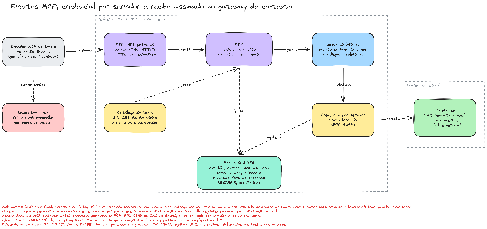

# Digest — IA, ML e dados · 23 nov 2026 (segunda)

## O que prestar atenção hoje

- O MCP passa a ter eventos. A extensão Events (`io.modelcontextprotocol/events`, SEP-3415 Final, extensão em Beta, 20/11) deixa o cliente assinar eventos de sistemas upstream por poll, stream ou webhook assinado com HMAC, com cursor para retomar e `truncated: true` quando houve perda. Para o Gateway de contexto, é uma entrada nova: o PDP precisa decidir na assinatura e de novo na entrega, e o evento nunca autoriza ação sozinho.
- Modelos de decisão chegam ao warehouse. O Snowflake Decision (Preview no AI_COMPLETE, 20/11) devolve escolha, nota ou probabilidade com confiança, a US$ 0,042 por milhão de tokens e cerca de 1,58 ms por linha (números do fornecedor). No mesmo fim de semana, o LEVER (arXiv 2611.27016) vira cerca de um terço das decisões corretas do Jev só com comentários, sem fato novo, e o Provenance Gate bloqueia tudo com no máximo uma consulta extra.
- A base do RAG e retrieval precisa de controle de admissão. O GraphRAG Zero (Microsoft Research) monta o grafo só com embeddings e sobe a cobertura de asserções globais de 53,4% para 57,4% contra RAG vetorial. Já dois trabalhos sobre envenenamento mostram que filtrar o trecho editado não devolve a resposta: o que funciona é procedência (manifesto do corpus) e checagem contra a fonte confiável.

## 1. Eventos no MCP: assinatura, entrega e retomada (extensão Events em Beta, 20/11)

- **O que é.** O MCP era só pedido e resposta. A extensão Events permite que um cliente assine eventos de um sistema upstream (e-mail novo, push num repositório, incidente) com argumentos, e que o agente reaja mesmo sem usuário presente. A SEP-3415 está Final e a extensão está em Beta, mantida pelo Tasks and Events Working Group. No PR do SDK TypeScript, ainda aberto, Events só é servido em sessões que negociaram a revisão 2026-07-28 do protocolo.
- **Como funciona.** O servidor anuncia a extensão em `server/discover`, e o cliente chama `events/list`, em que cada tipo de evento tem `inputSchema` (argumentos da assinatura), `payloadSchema` e modos de entrega. São três modos: `events/poll` (servidor sem estado por cliente), `events/stream` (requisição longa) e `events/subscribe` (webhook HTTPS com TTL renovável). Cada ocorrência chega como `{eventId, name, timestamp, data, cursor}`. O cliente guarda o cursor e retoma por ele; se o servidor não consegue servir daquela posição, responde `truncated: true`. A entrega é at-least-once quando o upstream é durável, e o `eventId` estável serve para deduplicar.
- **Segurança.** Payloads são dados não confiáveis (podem trazer prompt injection) e devem ser mínimos. O servidor checa permissão na assinatura, recheca na entrega e encerra a assinatura se o acesso for revogado. Receber um evento nunca autoriza o agente a agir, porque as tool calls seguintes passam pela autorização normal do MCP. Os webhooks são assinados com Standard Webhooks (HMAC), a URL de callback precisa ser HTTPS e verificada, e o servidor valida o IP de destino contra SSRF.
- **Para o gateway de contexto.** O webhook entra pelo PEP, que valida a assinatura HMAC e o TTL antes de qualquer coisa. O PDP reavalia o direito na entrega, com a mesma tabela de direitos da consulta. Um `truncated: true` é tratado como fail closed para a parte do estado que depende do evento: o brain reconcilia por consulta normal em vez de presumir continuidade. O recibo SHA-256 ganha `eventId`, cursor, modo de entrega e a decisão, e o payload vai para o contexto marcado como não confiável. Nos brains só de leitura, o evento serve para invalidar cache ou disparar uma releitura, nunca para executar uma ação.
- **Na comunidade:** o anúncio de Peter Alexander, autor da SEP (20/11), tinha 577 curtidas, 68 reposts e 54 respostas em 23/11: https://x.com/Poita_/status/2123812640254251472. O post "MCP is becoming event-driven" (21/11) teve 97 curtidas e 19 reposts: https://x.com/RohitGite19/status/2124018516621971912
- Fontes: https://modelcontextprotocol.io/extensions/events/overview · https://github.com/modelcontextprotocol/typescript-sdk/pull/3209

## 2. Recibos assinados fora do processo e desfechos incertos (arXiv 2611.27095 e 2611.26966, 20/11)

- **Epistemic Guard.** É uma biblioteca Python aberta (v0.5.2, MIT) com um proxy stdio de recibos MCP que roda fora do processo do agente. As chaves Ed25519 ficam isoladas fora do processo, os recibos vão para um log Merkle no formato do RFC 6962 (com tradução para AER-1), a prosa depois de cada turno é conferida em CPU com encoders INT8 cujo SHA-256 é verificado, e as gravações de memória passam por um portão com 7 domínios de procedência. O alvo são três falhas: o agente narrar efeitos que falharam ou não rodaram, texto não verificado entrar na memória durável junto com saídas reais de tools e páginas espelhadas contarem como fontes independentes. Nos testes de conformidade, rejeita 100% dos recibos adulterados (200 folhas Merkle) e bloqueia 100 de 100 gravações de memória não autorizadas. Em 250 traces congelados, chega a 93,2% de acurácia com mediana de 17,9 ms em CPU. Em 60 traces ao vivo, pega 96,15% dos riscos, mas com 38,24% de falso positivo (números dos autores).
- **OPCP (Keep the Process, Change the Supplier).** É uma proposta de governança de agentes em tempo de execução: uma fronteira que separa a proposta do agente da autoridade do negócio, da divulgação de contexto e da escolha do fornecedor, e que registra o desfecho incerto quando um fornecedor pode ter agido sem devolver resposta aceitável. Em 2.400 episódios com falha, "retry-all" duplicou efeitos em todos os casos de resposta perdida depois do commit; o estado persistente do runtime evitou replay entre fornecedores nos reinícios. Com 128 fornecedores, o roteamento por melhor nota teve mediana de 1,411 ms contra 0,261 ms do roteamento fixo. Os autores deixam claro que nenhum LLM foi avaliado.
- **Para o gateway de contexto.** São duas peças que faltam no desenho. A primeira é a chave de assinatura do recibo fora do processo do PDP: o PDP calcula o SHA-256 e um assinador separado assina e encadeia num log Merkle, então um PDP comprometido não reescreve o histórico. A segunda é um estado "incerto" no recibo, ao lado de permit e deny, para timeout depois do envio à fonte. Nos brains só de leitura, isso pede que a consulta seja refeita na mesma fonte, nunca em outra, e que a resposta diga que houve repetição. A taxa de 38% de falso positivo ao vivo também mostra que a checagem da prosa deve marcar e não bloquear.
- Fontes: https://arxiv.org/abs/2611.27095 · https://github.com/AlienatedAliens/epistemic-guard · https://arxiv.org/abs/2611.26966

## 3. Credencial por servidor MCP e descrição de tool como superfície de ataque (Apache Gravitino MCP Gateway, beta; arXiv 2611.27041, 20/11)

- **Apache Gravitino MCP Gateway.** O repositório (criado em 18/11, Apache-2.0, beta) é um gateway de autenticação para servidores MCP dentro do projeto Apache Gravitino. O usuário entra por OAuth no IdP (Okta, Keycloak, Entra ID), por navegador ou device flow (RFC 8628), e o gateway publica protected-resource metadata (RFC 9728). Para cada servidor MCP, ele resolve a credencial: o token do próprio chamador, token trocado (RFC 8693 ou o on-behalf-of do Entra), token conectado pelo usuário, token curto assinado pelo gateway ou basic auth. Os tokens guardados são cifrados com AES-256-GCM. O proxy fica em `/mcp/<server ID>` com filtro de tools por servidor, o acesso é pedido pelo usuário e aprovado por um admin, e o log de auditoria guarda as chamadas repassadas, as recusadas e as mudanças de admin.
- **GRAFT.** O trabalho otimiza descrições de tools de servidores MCP de terceiros para induzir argumentos maliciosos nas tool calls, mantendo a descrição com cara de benigna. Uma máscara acha as posições de tokens ligadas aos argumentos, e um LLM propõe mutações guiadas pelas escolhas de tool e pelos argumentos gerados. Nos três datasets públicos, o ataque teve sucesso maior que as alternativas com baixa detecção em cinco defesas por filtro, e continuou melhor que os baselines mesmo contra uma defesa adaptativa treinada com as próprias injeções.
- **Para o gateway de contexto.** A troca de token por servidor (RFC 8693) é um padrão natural para o PEP; o Gravitino serve de referência aberta para comparar campos de auditoria. O GRAFT mostra que a descrição da tool faz parte da política: o catálogo do PDP fixa o SHA-256 da descrição e do schema aprovados, o PEP compara a cada `tools/list` e nega (fail closed) quando o hash muda, e o hash entra no recibo. Filtros de conteúdo sobre a descrição não bastam.
- **Na comunidade:** no r/mcp (22/11, 3 pontos e 8 comentários), a thread "mcp tool descriptions are basically the new seo now?" discute descrições escritas para serem escolhidas pelo modelo: https://www.reddit.com/r/mcp/comments/1y2wckc/mcp_tool_descriptions_are_basically_the_new_seo/
- Fontes: https://github.com/apache/gravitino-mcp-gateway · https://arxiv.org/abs/2611.27041

## 4. Modelos de decisão no warehouse, no risco de crédito e sob manipulação (Snowflake, 20/11; arXiv 2611.26999 e 2611.27016, 20/11)

- **Snowflake Decision (Preview).** É um modelo próprio para classificação, nota e decisão em volume, chamado com `AI_COMPLETE(model => 'snowflake-decision', ...)`. A entrada é um `state` (texto ou dado estruturado) e um conjunto de perguntas tipadas (escolha, nota numa rubrica ordenada ou probabilidade de uma afirmação ser verdadeira), e a resposta volta num único objeto com a opção, a probabilidade e um valor de confiança. A documentação avisa que probabilidade e confiança não são intercambiáveis: a probabilidade é da opção escolhida, e a confiança reflete a distribuição entre as opções. O preço anunciado é de US$ 0,042 por milhão de tokens, com cerca de 1,58 ms por linha. O pré-requisito é `CORTEX_ENABLED_CROSS_REGION` em `AWS_US`, `AWS_GLOBAL` ou `ANY_REGION`. A documentação cita roteamento de tool ou agente como caso de uso.
- **JevRisk.** O trabalho propõe risco financeiro zero-shot em dois passos. Primeiro, o código calcula indicadores exatos de risco seguindo diretrizes regulatórias. Depois, um modelo de decisão de linguagem (Jev) lê esses indicadores junto com o perfil e a atividade do cliente e devolve a nota de alto risco. Em lavagem de dinheiro (dados sintéticos públicos do Scotiabank) e risco de crédito (Home Credit e Lending Club), supera métodos baseados em regras e não supervisionados e fica no nível ou acima de métodos supervisionados (GBDT, TabPFN) treinados com cerca de mil clientes rotulados.
- **LEVER e Provenance Gate.** Modelos de decisão tipada respondem só com probabilidade, opção ou nota, e instruções injetadas raramente funcionam neles. O LEVER mostra outro caminho: comentários externos escritos com quatro alavancas da teoria da argumentação, filtrados por um verificador para não adicionar fato nenhum, viram cerca de um terço das decisões corretas do Jev, 2,8 vezes mais que o ataque anterior mais forte, e ainda mais em outros cinco modelos. O Provenance Gate aceita uma decisão alterada só se o modelo chegar a ela de novo sem os comentários externos, e bloqueia todos esses ataques com no máximo uma consulta extra.
- **Para quem monta brains analíticos.** Num caso de risco de crédito, o desenho do JevRisk é o padrão a seguir: os indicadores saem do warehouse e do dbt Semantic Layer por código, e o modelo de decisão só julga. O LEVER pede que o state separe campos de fonte confiável de texto externo (comentário de gerente, e-mail do cliente), e que o PDP rode a decisão duas vezes quando houver texto externo, aceitando a mudança só se ela se mantiver sem esse texto, com as duas probabilidades no recibo. No Snowflake Decision, o recibo guarda opção, probabilidade e confiança separadas. A inferência cross-region fora do Brasil é ponto de LGPD e regulação setorial a resolver antes de qualquer dado de cliente passar por ela.
- Fontes: https://docs.snowflake.com/en/release-notes/2026/other/2026-11-20-ai-complete-snowflake-decision-public-preview · https://docs.snowflake.com/en/user-guide/snowflake-cortex/snowflake-decision · https://arxiv.org/abs/2611.26999 · https://arxiv.org/abs/2611.27016

## 5. GraphRAG só com embeddings e diagnóstico do que falta no grafo (Microsoft Research; arXiv 2611.27350, 20/11)

- **GraphRAG Zero.** É a nova geração do GraphRAG da Microsoft Research (texto publicado em 17/11; ganhou tração no X no fim de semana). Elimina chamadas de LLM na indexação, porque o grafo é derivado só da geometria dos embeddings, e numa configuração de tempo real também recupera contexto sem LLM, deixando o modelo generativo só para a resposta final. Está disponível como opção no Foundry IQ (Azure AI Search) e no Repo Mind Light do GitHub Next. No estudo, com 200 perguntas sintéticas (metade multi-hop, metade globais) sobre transcrições de podcast e notícias e orçamento de 50 chunks, a cobertura de asserções globais subiu de 53,4% (RAG vetorial) para 57,4%, com o mesmo modelo de embedding e o mesmo gerador. O contexto ficou pronto em 0,93 s em média, sem contar a geração. O GraphRAG Zero teve maior recall de clusters, e o RAG vetorial manteve maior precisão de chunk. A Microsoft avisa que esses resultados de pesquisa não são medições do serviço Foundry IQ.
- **GRACE.** É um benchmark que executa consultas do LC-QuAD 2.0 sobre o Wikidata e aplica quatro intervenções controladas a cada subgrafo de evidência: cortar o caminho de suporte, adicionar distratores de tipo compatível, ligar hubs de alto grau e trocar a resposta por uma entidade contrafactual. São 4.028 perguntas e 20.140 pares pergunta-grafo. Roteamento só pela pergunta não distingue os estados da evidência, e orientação por relevância ajuda quando há resposta, mas atrapalha quando o caminho foi cortado. O método proposto (QCFSE-SA, com um gate calibrado de suporte do grafo) sobe a acurácia controlada de 57,17% para 62,78% e a do estado quebrado de 55,41% para 67,85%.
- **Para quem monta brains analíticos.** As métricas do GraphRAG Zero (recall de clusters relevantes e cobertura de asserções, medidos separadamente da resposta) são as que faltam na avaliação dos brains para perguntas globais, como "quais os principais motivos de atraso na carteira de crédito". O GRACE dá o teste de regressão do grafo: cortar a aresta de suporte e verificar se o brain se abstém em vez de completar com conhecimento do modelo. O grafo só com embeddings pode substituir a extração por LLM em documentos, mas a Ontologia como código continua como fonte das relações de negócio.
- **Na comunidade:** @OpenKGraphs (21/11, 22 curtidas) destacou que o GraphRAG Zero monta o grafo sem LLM e que a implementação é proprietária: https://x.com/OpenKGraphs/status/2124200924776116685
- Fontes: https://www.microsoft.com/en-us/research/story/the-evolution-of-graphrag-advancing-systems-and-evaluation-together/ · https://arxiv.org/abs/2611.27350

## 6. Envenenamento da base de conhecimento: filtrar não devolve a resposta (arXiv 2611.27410 e 2611.27460, 20/11)

- **Troca de palavras por sinônimos.** Num RAG de cibersegurança sobre MITRE ATT&CK e CAPEC, um atacante edita passagens existentes trocando palavras por sinônimos (PWWS, TextFooler). Num benchmark revisado de 44 perguntas, a correção julgada caiu de 0,714 para 0,555, mais por evidência perdida e recusas do que por afirmações falsas. Um termo da entropia relativa (o log-ratio entre a palavra e o sinônimo mais provável, com um modelo pequeno como referência) detecta as edições com AUROC de 0,95. Usado como filtro, reduz pela metade quanto texto editado chega ao gerador, mas não recupera a correção, porque o trecho editado costuma ser o que tinha a resposta. Um monitor que confere cada resposta contra o STIX confiável da MITRE reduz a exposição de 0,41 para 0,26, e a correção sobe para 0,786 quando ele pode trazer a entrada confiável como fonte.
- **LightRAG com normas de construção.** Uma tese com experimento pré-registrado testa quatro ataques (texto, grafo, emenda fabricada e atacante adaptativo) contra defesas nas camadas de retrieval, grafo e geração. As configurações com a camada de geração passaram no critério recusando de 69% a 80% das consultas envenenadas, a um custo de até 74 pontos de acurácia limpa. Já o filtro de procedência no retrieval não teve custo mensurável de acurácia limpa. O texto também chegou ao gerador pelas descrições de entidades e relações do grafo, um caminho que nenhuma camada inspecionava. Os autores avisam que uma taxa zero de sucesso de ataque só tem valor junto com a taxa de recusa.
- **Para quem monta brains analíticos.** O corpus de documentos dos brains precisa de um manifesto de admissão: cada documento com origem, versão e hash, e retrieval que só devolve o que está no manifesto (fail closed para o resto). As descrições geradas para o grafo precisam do mesmo controle que os chunks. Na avaliação, reportar sempre recall e taxa de recusa juntos. Para números regulatórios, a checagem final é contra a tabela de referência (a fonte confiável), não contra o chunk recuperado.
- Fontes: https://arxiv.org/abs/2611.27410 · https://arxiv.org/abs/2611.27460

## 7. Context bank do text-to-SQL apodrece, e perguntar só quando a execução diverge (arXiv 2611.26775, 19/11, e 2611.27474, 20/11)

- **Know Your Context Bank.** Sistemas de text-to-SQL dependem de context banks: exemplos de consulta, definições de métricas e conhecimento de domínio que crescem por anos, com entradas revisadas uma a uma quanto à correção, mas raramente quanto à consistência entre si. Duas entradas podem passar na revisão e resolver a mesma decisão (como contar uma entidade, que tabela a define) de formas opostas, o que os autores chamam de "context bank rot". Comparando consultas decisão por decisão, com um avaliador rápido destilado de juízes LLM calibrados por humanos: fine-tuning num bank do BIRD-train limpo supera um subconjunto aleatório do mesmo tamanho em todas as épocas (+2,6 pontos em média), e 92,4% das remoções tinham o SQL corrigido numa auditoria independente, contra 45,6% das entradas auditadas. Exemplos que seguem uma convenção superam os da convenção oposta por 13,3 pontos, e misturar as duas quase não ajuda. O benefício do bank cai com a distância da pergunta e some quando cerca de três quartos da lógica são novos.
- **AskWise.** Executa as consultas candidatas sobre possíveis reparos do dado e pergunta ao usuário só quando duas execuções diferem numa única escolha e dão respostas diferentes. Em 155 perguntas, podar os candidatos nos dois estados do banco sobe o recall das assinaturas de resposta em 8,71 pontos (Doubao Lite) e 10,00 (GPT Sol).
- **Para quem monta brains analíticos.** O dbt Semantic Layer resolve parte do problema ao fixar a definição de cada métrica num lugar só, mas os exemplos few-shot e as notas de domínio dos brains são um context bank com o mesmo risco. A sugestão é versionar o bank em Git junto com a ontologia como código, marcar cada entrada com a convenção que segue (por exemplo, inadimplência por contrato ou por CNPJ) e rodar a comparação decisão por decisão no CI. Pergunta muito distante do bank deve ir para a rota de métrica certificada ou para recusa, não para SQL livre.
- Fontes: https://arxiv.org/abs/2611.26775 · https://arxiv.org/abs/2611.27474

## 8. Dados: filtros nos índices vetoriais, qualidade no catálogo e timeouts (AWS, Databricks, Snowflake, 20/11)

- **Amazon S3 Vectors.** O limite de metadados filtráveis subiu de 2 KB para 40 KB por vetor, por exemplo para categoria, permissões, timestamps e tags. Índices em buckets novos já vêm com o limite maior; índices existentes precisam passar para enhanced index mode com a API `UpdateIndexMode`.
- **DynamoDB vector search.** Os filtros inline do `SearchVectors` passaram a aceitar `<`, `<=`, `>`, `>=` e `BETWEEN` em atributos numéricos, `IN`, `attribute_exists`/`attribute_not_exists` e `AND`, `OR` e `NOT`. O filtro é aplicado durante a busca, então todo resultado devolvido atende a condição.
- **AWS Glue Data Catalog.** Ganhou monitoramento de qualidade de dados para catálogos e bancos inteiros: as checagens (perfil embutido ou DQDL) são definidas uma vez e valem para todas as tabelas do escopo, inclusive as criadas depois, por agenda ou a cada mudança de metadados, incluindo cada commit Iceberg. Depois de três execuções numa tabela, estatísticas fora do esperado são marcadas como anomalia.
- **Databricks e Snowflake.** No Databricks, o timeout de statement por warehouse entrou em GA (campo `statement_timeout` na API de SQL warehouses, SDKs, Terraform e bundles). No Snowflake, os access roles de Postgres para autenticação por token entraram em GA (tokens curtos para conectar como um usuário Postgres, com os privilégios ainda controlados pelos papéis do Postgres), e o modo AUTO das dynamic tables novas passa a resolver para ADAPTIVE em vez de INCREMENTAL.
- **Para quem monta brains analíticos.** Com 40 KB de metadados, o filtro de direitos do PDP (carteira, segmento, classificação) cabe no próprio vetor, e o filtro durante a busca evita o top-k esvaziado de um pós-filtro, sem substituir a Busca híbrida para CNPJ e números de contrato. O `statement_timeout` por warehouse é o limite rígido abaixo do timeout do PEP: o PEP precisa cortar antes, para que o recibo registre o timeout como decisão e não como erro. O monitoramento de qualidade a cada commit Iceberg serve de sinal para o PDP negar uma rota de métrica quando a tabela de origem estiver com anomalia aberta.
- Fontes: https://aws.amazon.com/about-aws/whats-new/2026/11/amazon-s3-vectors-raises-filterable-metadata-40kb-per-vector/ · https://aws.amazon.com/about-aws/whats-new/2026/11/dynamodb-vector-filters/ · https://aws.amazon.com/about-aws/whats-new/2026/11/glue-catalog-data-quality-monitoring/ · https://docs.databricks.com/aws/en/release-notes/product/2026/november · https://docs.snowflake.com/en/release-notes/2026/other/2026-11-20-postgres-token-access-roles-ga · https://docs.snowflake.com/en/release-notes/2026/other/2026-11-20-dynamic-tables-auto-resolves-to-adaptive

## Diagrama

Editável: [2026-11-23-eventos-mcp-recibo.excalidraw](../../assets/2026-11-23-eventos-mcp-recibo.excalidraw)

## Repos em alta

- **bluesky-social/diderot**: https://github.com/bluesky-social/diderot · 48 stars (API do GitHub, 23/11) · criado em 20/11/2026 · licença Apache-2.0. Servidor self-hosted que responde perguntas sobre o que a organização escreveu. Ingere Slack, Discord, sessões de agentes de código, Notion, Linear, Zendesk e pastas de Markdown num log de eventos em Postgres, indexa no Qdrant e responde com citações no Slack e como servidor MCP (`retrieve`, `list`, `expand`, `attachment`, `ask`). Cada evento carrega um escopo, e toda busca é filtrada pelos escopos de quem chama; a autenticação é por tokens OIDC do IdP. O próprio README avisa que o retrieval é só vetorial, sem reranker e sem índice de palavras-chave. O que muda: é uma referência de brains analíticos com permissão por evento aplicada no retrieval e MCP como interface, e também um exemplo do que falta para os brains analíticos (léxico e reranker para IDs e termos exatos).
- **Vision-Decision/Glance-Engine**: https://github.com/Vision-Decision/Glance-Engine · 30 stars (API do GitHub, 23/11) · criado em 19/11/2026 · licença Apache-2.0. Engine que serve modelos de decisão de visão: lê a imagem uma vez e responde todas as perguntas tipadas (caixa, sim/não, escolha) num único forward pass com cabeças de leitura, em vez de gerar texto. As respostas são probabilidades calibradas por temperatura. O README reporta 48,9 ms para 32 perguntas sobre uma imagem, contra 334,0 ms do vLLM em BF16 (números do autor, numa RTX PRO 6000). O que muda: mostra o mesmo padrão do Snowflake Decision e do Jev aplicado a documentos escaneados, com várias perguntas tipadas por documento numa passada e a probabilidade de cada resposta indo para o recibo.

## Para aprofundar

- Right Numbers, Wrong Story (arXiv 2611.26968): rascunhos de relatório financeiro feitos por LLM acertam os números, mas acrescentam julgamentos e causas que ninguém forneceu. O FrameCheck remove isso por regra, sem chamada de modelo, em 17 LLMs abertos e 3 milhões de rascunhos, e aproxima a taxa de julgamentos à dos 10-K. É um pós-processamento natural para narrativas analíticas de risco de crédito: https://arxiv.org/abs/2611.26968
- Correct Precedents Induce Policy Violations (arXiv 2611.27216): depois de liberar corretamente um item cuja restrição caiu, o agente fica mais propenso a liberar o próximo item ainda restrito. Um único precedente correto pode cortar pela metade a taxa segura do agente mais afetado, em 13 modelos abertos. É mais um argumento para o PDP decidir item por item, fora do histórico do agente: https://arxiv.org/abs/2611.27216
- NGAC-IR (arXiv 2611.26941): o LLM preenche uma representação intermediária em JSON com gramática, um compilador sem LLM gera o grafo de política NGAC ligado à frase de origem, e uma retrotradução manda 10,5% das frases para revisão humana, achando 26 de 31 erros. No Policy Machine do NIST, as políticas deram a decisão esperada nos 390 pedidos de acesso. É um caminho para escrever a tabela de direitos do PDP a partir de normas internas em texto: https://arxiv.org/abs/2611.26941
- SkillPrivus (arXiv 2611.26747): auditoria estática de 726 skills de marketplaces públicos, das quais 563 lidam com dados pessoais; 307 delas (54,5%) tiveram ao menos uma violação potencial de privacidade, com 83,2% de concordância com anotadores humanos. É relevante para LGPD antes de instalar skills nos agentes dos brains: https://arxiv.org/abs/2611.26747
- Decision Columns as an Index (arXiv 2611.27910): embeddings interpretáveis em que cada coordenada é a resposta calibrada de um modelo de decisão a uma pergunta (sim, não, não declarado). A similaridade se decompõe por pergunta, e novas perguntas entram sem recodificar o corpus. Perguntas tiradas de falhas de retrieval triplicam o MRR: https://arxiv.org/abs/2611.27910
- AWS Quick enterprise guardrails (preview, 20/11): políticas por usuário, grupo do IdP ou padrão da conta, com o mais restritivo valendo quando grupos se sobrepõem e um modo só de detecção que registra sem bloquear. É o mesmo padrão de "shadow mode" que o PDP pode usar antes de ativar uma regra nova: https://aws.amazon.com/about-aws/whats-new/2026/11/aws-quick-enterprise-guardrails-preview/
- No r/AI_Agents (22/11, 8 pontos e 19 comentários), a thread "Does AI Agent Memory Actually Make Agents Smarter?" discute quando a memória persistente ajuda e quando só acumula ruído: https://www.reddit.com/r/AI_Agents/comments/1y2tczi/does_ai_agent_memory_actually_make_agents_smarter/
