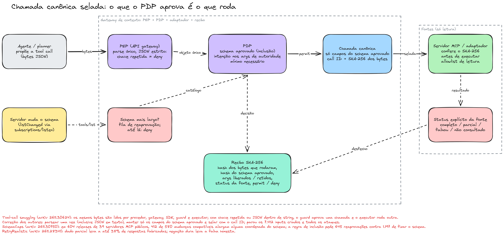

# Digest — IA, ML e dados · 24 nov 2026 (terça)

## O que prestar atenção hoje

- No Gateway de contexto, a chamada que o PEP aprova pode não ser a que roda. O trabalho sobre tool-call smuggling (arXiv 2611.30624) mostra que os mesmos bytes JSON lidos por gateway, guard e executor podem virar chamadas diferentes, e que a auditoria registra só a aprovada. A correção dos autores é parsear uma vez, manter só os campos do schema aprovado e selar a chamada com o call ID, o que parou os 7.412 inputs criados. No mesmo dia, o SchemaCaps mostra que 412 de 580 mudanças "compatíveis" de schema em servidores MCP públicos alargam algum argumento, e o FastMCP 4.2.5 passou a anunciar `listChanged` por padrão.
- Para quem monta brains analíticos, dado parcial é pior que erro. No RetryRealistic (arXiv 2611.28341), de 6% a 26% das execuções com falha injetada terminam numa resposta errada dita com confiança, e falhas que devolvem dado parcial chegam a 38% de fabricação, enquanto negações duras levam a falha honesta. É um argumento empírico para fail closed e para status explícito de cada fonte no recibo.
- No RAG e retrieval, o SupportChain chega a 63,0 F1 no MuSiQue com um leitor de 9B e sem construir índice de grafo (o melhor resultado anterior era 59,2, com 20B). O índice abc mostra que busca esparsa aprendida exata pode ser mais rápida que a aproximada em k alto. Do lado de privacidade, manter o histórico da conversa num RAG multiplica por 3,6 a 4,9 o vazamento de dados de treino.

## 1. O guard aprova uma chamada e o executor roda outra (arXiv 2611.30624, 23/11)

- **O que é.** Numa tool call, o modelo escreve os argumentos em JSON, um guard decide se a chamada pode rodar e um executor a executa. Os mesmos bytes são parseados várias vezes: pelo provedor, por gateways, SDKs, frameworks, pelo guard e pelo executor. O JSON deixa escolhas para cada parser, como qual cópia de uma chave repetida vale. Quando guard e executor escolhem diferente, o guard aprova uma chamada, o executor roda outra e o log de auditoria registra a aprovada. Os autores chamam isso de tool-call smuggling.
- **Como funciona.** Os autores descrevem seis formas de os mesmos bytes virarem chamadas diferentes e montam um harness diferencial com 17 configurações fixadas de parsers e validadores: a maioria dos pares discorda em algum input, e dois SDKs oficiais de MCP aceitam inputs diferentes. Em tarefas do τ-bench e do AgentDojo, um atacante que reescreve os bytes em trânsito cancela a reserva de outro cliente e cria um arquivo que o guard bloqueia pelo nome, enquanto o log cita só a chamada aprovada. Os dez modelos testados não escrevem chave repetida na chamada em si, mas copiam uma literalmente para JSON dentro de um argumento string, que um guard em Python e um executor em Go leem de forma diferente. Um servidor malicioso que copia o schema público de uma tool legítima e adiciona um campo, explicado numa nota, faz o modelo preenchê-lo com dados do usuário sem o guard ver. A defesa proposta é parsear cada chamada uma vez (inclusive o JSON em texto), manter só os campos do schema aprovado e entregar ao executor selada com o call ID; isso parou os 7.412 inputs criados e todos os ataques montados.
- **Para o gateway de contexto.** Um desenho de referência com PEP, PDP e adaptador da fonte tem três parsers, muitas vezes em linguagens diferentes. A sugestão é que o PEP rejeite JSON com chave repetida (fail closed) em vez de escolher uma cópia, e que o PDP não devolva só permit, mas a chamada canônica: o objeto já parseado, filtrado para os campos do schema aprovado e reserializado de forma determinística. O SHA-256 desses bytes canônicos vai junto com o call ID até o adaptador, que confere o hash antes de executar. Assim o recibo SHA-256 passa a provar o que rodou, e não só o que foi aprovado. Argumentos string que contêm JSON precisam ser parseados pelo PDP também.
- Fontes: https://arxiv.org/abs/2611.30624

## 2. Schema de tool que muda sem reaprovação, e o MCP passa a avisar (arXiv 2611.30750; FastMCP 4.2.5, 23/11)

- **SchemaCaps.** As tools que o usuário aprova para o agente mudam de input schema com frequência. Dos 8 clientes e scanners MCP avaliados, nenhum reaprova uma tool cujo schema fica mais largo (em dois não foi possível determinar). O trabalho define não amplificação sobre os argumentos declarados e os campos não declarados, e uma regra de reaprovação decidida por inclusão de subschema, sem confiar em rótulos de campo, com prova de composição em Coq e 48 testes de regressão. Num piloto com 604 releases de 39 servidores MCP públicos, 412 de 580 mudanças compatíveis alargam alguma coordenada, e pelo menos 76 adicionam ou alargam um argumento que carrega autoridade. Nas tools existentes, a regra pede 645 reaprovações, contra 1.197 de fixar o input schema (2.004 se fixar também as descrições) e 617 de aceitar tudo que é compatível. Mudança de comportamento com schema idêntico fica fora do alcance (aceito na ICAART 2027).
- **FastMCP 4.2.5 (23/11).** Em conexões da revisão 2026-07-28 do protocolo, o servidor passa a servir `subscriptions/listen` e a anunciar `listChanged` e `resources.subscribe` por padrão, e `notify_tools_changed()` empurra o evento para os clientes que estão ouvindo. Cada processo aceita até 1.024 streams abertos, e o evento só chega a clientes conectados ao mesmo processo (com várias réplicas, não se propaga). Dá para desligar com `FASTMCP_ENABLE_SUBSCRIPTIONS_LISTEN=false`. A versão também traz o `UsageMiddleware` (histograma OpenTelemetry `mcp.server.operation.duration` por usuário e por tool), impede que o documento de metadados de um cliente CIMD alargue os escopos permitidos e encerra o grant inteiro quando um refresh token rotacionado é reapresentado mais de 60 segundos depois.
- **Para o gateway de contexto.** Fixar o SHA-256 do schema e da descrição (sugestão do digest de 23/11) é seguro, mas no piloto custaria 2.004 reaprovações; a regra de inclusão custa 645 e pega os alargamentos. O catálogo do PDP guarda o schema aprovado e, a cada `tools/list`, aceita o novo schema se ele estiver contido no aprovado e nega até reaprovação quando alarga (fail closed); a descrição continua fixada por hash. Como o `listChanged` do FastMCP não atravessa réplicas, um PDP com várias réplicas não pode depender só do aviso: precisa também reler `tools/list` periodicamente e no início de cada sessão.
- Fontes: https://arxiv.org/abs/2611.30750 · https://github.com/PrefectHQ/fastmcp/releases/tag/v4.2.5

## 3. Argumento confiável, mas não pedido, e o mínimo necessário (arXiv 2611.30745 e 2611.30360, 23/11)

- **IntentFlow.** A procedência por argumento bloqueia valores que vêm de conteúdo não confiável, mas aceita um valor confiável que o usuário nunca pediu (destinatário, endpoint ou arquivo errado). O IntentFlow é uma camada de mediação entre o planner e as tools que confere cada argumento com autoridade contra um contrato de intenção e uma política de procedência. Em 200 ataques sintéticos, o sucesso cai de 50,5% com procedência só para 12,0% (IC 8,2% a 17,2%), e todo sucesso restante altera um campo de conteúdo. Não bloqueia nenhuma das 200 tarefas benignas pareadas e bloqueia 4 de 50 difíceis. Nos 50 ataques "confiável mas não autorizado", a mediação só por procedência executa os 50 e o IntentFlow nenhum; uma checagem estilo CaMeL também bloqueia os 50, mas rejeita 16 de 50 tarefas benignas. Com um planner ao vivo, bloqueou as 17 chamadas corrompidas propostas em 110 ataques.
- **ArguShield.** Mesmo sem intenção maliciosa, o agente preenche campos amplos com dados pessoais desnecessários para a tool que recebe. O ArguShield intercepta a chamada e avalia cada valor por três sinais (procedência do valor, relevância para a tarefa e fronteira de divulgação), liberando, adiando para confirmação ou retendo. No ArgPrivBench (120 tarefas de viagem, compras e saúde), a liberação silenciosa não autorizada cai para 9% nas tarefas padrão e 6% nas de alto risco, mantendo o sucesso recuperável.
- **Para quem monta brains analíticos.** Nos brains só de leitura, os argumentos de consulta (CNPJ, carteira, período, segmento) são os que carregam autoridade. O PDP pode montar o contrato de intenção a partir da pergunta e da tabela de direitos e negar quando o CNPJ na chamada não é o da pergunta, mesmo que o valor venha de fonte confiável. O ArguShield é a forma operacional do princípio da necessidade da LGPD na saída para tools de terceiros, e o recibo pode registrar quais argumentos foram liberados e quais retidos.
- Fontes: https://arxiv.org/abs/2611.30745 · https://arxiv.org/abs/2611.30360

## 4. Descoberta de endpoints LLM, MCP e A2A e regras de protocolo no WAF (AWS, GA, 23/11)

- **O que é.** A AWS lançou em GA a descoberta automática de endpoints de LLM, MCP e A2A atrás do API Gateway, de Application Load Balancers e do CloudFront em toda a AWS Organization. A descoberta fica no novo API Gateway API Portal, que reconhece os endpoints de IA entre as APIs que encontra pelos logs de tráfego e registros de configuração, sem agente nem encaminhamento de logs; um servidor MCP público e não documentado aparece como shadow API.
- **Como funciona.** A proteção vem no novo grupo de regras gerenciadas AWS WAF AI Security, que reconhece o protocolo e bloqueia mensagens MCP e A2A malformadas. Com inspeção de conteúdo ligada, o grupo chama a API `InvokeGuardrailsCheck` do Amazon Bedrock Guardrails para detectar prompt injection, jailbreak, conteúdo nocivo nas requisições e informação sensível nas respostas (cobrado à parte). O API Portal está em 32 regiões; o AI Security, em sete (N. Virginia, Ohio, Oregon, Londres, Estocolmo, Tóquio e Sydney), sem São Paulo na lista.
- **Para o gateway de contexto.** A garantia do gateway é que todo contexto passa pelo PEP. Um servidor MCP alcançável sem passar pelo PEP quebra a auditoria, então o inventário de endpoints de IA é parte do controle, e não só higiene. A checagem de conformidade de protocolo na borda é a mesma ideia do item 1: rejeitar a mensagem malformada antes de qualquer parser de negócio. Fora da AWS, essa camada fica no PEP do gateway; o anúncio serve como lista de verificação do que a borda precisa cobrir.
- Fontes: https://aws.amazon.com/about-aws/whats-new/2026/11/waf-ai-endpoint-discovery-protection/

## 5. Text-to-SQL: grão da medida contra fan-out e abstenção com garantia (arXiv 2611.29009 e 2611.31190)

- **Fan-out.** Agregações sobre joins um-para-muitos e muitos-para-muitos contam a mesma entidade mais de uma vez, e a consulta roda e devolve um número plausível. A condição depende de dois fatos que o schema não mostra: o grão de cada medida e quantas linhas um join em cada chave repete. Uma auditoria sobre os dados acha respostas-gabarito distorcidas em 4,2% das perguntas de dev do BIRD, e a revisão independente do BIRD mudou 44% das respostas marcadas como fan-out certo, contra 16% das não marcadas. Os autores publicam o BIRD-FanOut (486 perguntas com gabarito revisado) e o GrainTraps. Em oito agentes, dependências funcionais calculadas dos dados não ajudam mais que estatísticas por coluna, mas dependências com grão (que informam o grão de cada medida e a repetição por chave) cortam os erros de fan-out no BIRD de 18,4% das execuções para cerca de 13%.
- **Abstenção conformal.** Um LLM gerador escreve e executa a consulta e um LLM crítico diferente julga a consulta e o resultado; os sinais vão para um Random Forest. Um limiar Learn-then-Test garante, com probabilidade 1−δ, que o erro entre as consultas aceitas fica abaixo de um orçamento escolhido. No Spider, sem abstenção 22,6% das consultas estão erradas; com orçamento de 15% (δ = 0,1), o sistema aceita em média 52,4% das consultas com 9,1% de erro observado. No BIRD sem retreino, os scores continuam informativos (AUROC 0,72 contra 0,79 no Spider), mas a garantia não se transfere.
- **Para quem monta brains analíticos.** O dbt Semantic Layer já declara o grão de cada semantic model pelas entidades, então as perguntas que caem em métricas definidas ficam protegidas. O risco está no fallback para SQL livre. Ali, o contexto entregue ao modelo precisa trazer o grão de cada medida e a repetição por chave, por exemplo saldo por contrato, contratos por CNPJ e garantias por contrato num caso de risco de crédito, e isso cabe na Ontologia como código em Git. A abstenção conformal é uma saída natural do roteador (Modelos de decisão): calibrar o limiar no conjunto de perguntas com gabarito de cada domínio, registrar o score no recibo e responder "não sei com segurança" abaixo dele. O resultado no BIRD mostra que a calibração precisa ser refeita por domínio.
- Fontes: https://arxiv.org/abs/2611.29009 · https://github.com/ahmed-mahran/misqal · https://arxiv.org/abs/2611.31190

## 6. Quando a tool falha, o agente inventa (arXiv 2611.28341 e 2611.30243)

- **RetryRealistic.** É um ambiente isolado, mas realista, com sistema de arquivos com permissões reais, SQLite, um servidor HTTP local determinístico e um shell restrito: 8 tools, 9 tipos de falha com persistência controlada e 30 tarefas de vários passos. Em 2.100 execuções com falha injetada em quatro agentes, a recuperação correta vai de 19% a 68%, e de 6% a 26% das execuções terminam numa fabricação confiante. O tipo de falha pesa mais que o modelo: falhas que devolvem dado parcial levam a até 38% de fabricação, e negações duras levam a falha honesta. O mecanismo é a ingestão silenciosa: o agente aceita o dado defeituoso no primeiro contato e constrói a resposta sobre ele. Um monitor que confere a saída estruturada das tools e dá instruções corretivas (em vez de bloquear) sobe a recuperação correta de 45,6% para 56,3% e corta a fabricação de 17,3% para 10,8%. Tirar o chain-of-thought aumenta a fabricação em 8,3 pontos.
- **Agentes de busca que não se corrigem.** No BrowseComp-Plus, uma resposta anterior confiante do assistente reduz em 16,1 pontos a acurácia do Nemotron mesmo com a passagem certa no contexto; com o usuário insistindo, a queda é de 32,9 pontos (Nemotron) e 12,6 (gpt-oss). Pôr a página certa em primeiro lugar muitas vezes não faz o agente abri-la, e entregar a passagem decisiva no contexto melhora a acurácia em 51,0 pontos (Qwen3.5) e 22,4 (Nemotron).
- **Para quem monta brains analíticos.** O resultado sustenta o fail closed com números: uma fonte que falha por inteiro gera falha honesta, e uma que devolve metade gera resposta inventada. O adaptador de cada fonte precisa devolver um status explícito (completo, parcial, falhou ou não consultado), e o PDP pode negar a composição de resposta numérica quando alguma fonte veio parcial. No retrieval, o brain deve entregar o trecho decisivo no contexto em vez de um link para o agente abrir.
- **Na comunidade:** no r/mcp (23/11, 5 pontos e 14 comentários), a thread "What we left out of our MCP server, and what watching an agent use it taught us" discute separar "nenhum resultado" de "não buscou" e a divisão entre chaves de leitura e de escrita: https://www.reddit.com/r/mcp/comments/1y39gl0/what_we_left_out_of_our_mcp_server_and_what/
- Fontes: https://arxiv.org/abs/2611.28341 · https://github.com/Kingsford-Group/RetryRealistic · https://arxiv.org/abs/2611.30243

## 7. Multi-hop sem índice de grafo e busca esparsa exata (arXiv 2611.28519 e 2611.28555, 21/11)

- **SupportChain.** Os melhores resultados em perguntas multi-hop vêm de índices de grafo lidos por modelos de 70B ou mais, e construir o índice exige chamar um LLM sobre o corpus inteiro. O SupportChain quebra a pergunta em hops, amarra a resposta de cada hop a uma frase citada de uma passagem recuperada, estima a confiabilidade de cada execução pelo próprio trace e combina várias execuções pelo suporte das respostas, parando quando o suporte basta. Com um leitor de 9B no protocolo do HippoRAG 2, chega a 63,0 F1 no MuSiQue, acima do melhor resultado anterior (59,2, com leitor de 20B), e supera o HippoRAG 2 nos cinco datasets por até 17,2 F1, sem construir índice. O modelo de confiabilidade precisa de só 100 perguntas respondidas para treinar.
- **Índice abc.** Na busca esparsa aprendida (learned sparse retrieval), as consultas têm dezenas de termos com pesos, e a visão corrente é que índices aproximados (Seismic, HNSW) são mais rápidos que os exatos. O abc é exato e usa só técnicas clássicas (avaliação term-at-a-time, Block-Max MaxScore, binary packing e reordenação de doc-ids). No MS MARCO com quatro modelos esparsos, é o índice exato mais rápido em todo k: de 6,5 a 84 vezes mais rápido que a busca exata do Qdrant, de 13 a 55 vezes que a do Lucene e de 2,9 a 18 vezes que o BMP, com índice de 5 a 7 vezes menor. Contra os aproximados, ocupa de 1,5 a 3,6 vezes menos espaço; eles são até 4,3 vezes mais rápidos em k=10, mas em k=1000 o abc passa à frente por até 7,4 vezes. E não há parâmetro para ajustar.
- **Para quem monta brains analíticos.** O SupportChain é uma linha de base barata para comparar antes de investir em índice de grafo para perguntas multi-hop, e a resposta amarrada a uma frase citada por hop é exatamente a exigência de citação de um brain analítico. As 100 perguntas de treino cabem num conjunto de avaliação típico. O abc interessa à perna esparsa da Busca híbrida: é exato, então a mesma consulta devolve o mesmo top-k e o recibo fica reprodutível, e é rápido justamente no k alto que alimenta o reranker.
- Fontes: https://arxiv.org/abs/2611.28519 · https://arxiv.org/abs/2611.28555

## 8. Privacidade: histórico da conversa, memória de agentes e pseudonimização (arXiv 2611.28748, 2611.29804 e 2611.30353)

- **Vazamento em RAG conversacional.** O CRELT acompanha, turno a turno, quantos contatos reais dos dados de treino um sistema RAG revela, com um corpus de recuperação verificado sem nenhum desses dados e contando só o que não estava no input daquele turno (esse critério exclui de 29% a 53% das ocorrências brutas). Em GPT-J-6B, Pythia-6.9B e Pythia-12B, a recuperação reduz a divulgação, mas boa parte da redução vem só de haver mais contexto: passagens aleatórias de mesmo tamanho reproduzem de 91% a 99,5% dela com histórico limpo. Com recuperação, manter o histórico completo aumenta a divulgação de 3,6 a 4,9 vezes, e manter só um turno anterior já devolve o nível do histórico completo. Limpar o histórico reduz a divulgação de 72% a 79%, sem eliminá-la.
- **FORGETMENOT.** Em cerca de 3.800 sessões (perto de 6 milhões de tokens) com cinco agentes comerciais, os agentes guardam na memória atributos pessoais variados, inclusive de saúde, e a memória visível ao usuário revela bem menos atributos do que o agente guarda (cerca de 20% em média, segundo os autores). Os cinco agentes mostram vazamento depois da exclusão.
- **PseuDRAGON.** Para pseudonimizar dados financeiros em rede fechada, guarda os julgamentos confirmados e as correções fora de um modelo local fixo e os reaproveita por busca exata de nome de coluna e regras aprendidas; para revisão, consulta a política da instituição, depois a lei nacional de privacidade e depois fontes internacionais. Em 92 colunas de uma instituição, as regras sobem o reaproveitamento de 75 para 83 rótulos sem erro, e revisar ou retirar uma aprovação reconstrói as regras derivadas. O reaproveitamento pelo histórico cortou em média 83,0% do tempo de identificação automática.
- **Para quem monta brains analíticos.** A política de histórico é um controle de privacidade, não só de custo: o PDP pode decidir quanto histórico entra em cada turno quando a pergunta toca dados pessoais (sócios de PJ, por exemplo) e registrar isso no recibo. Se os brains ganharem memória, a exclusão precisa ser testada, o que pesa para os direitos do titular na LGPD. O PseuDRAGON é o mesmo desenho da ontologia como código: a classificação de dado pessoal por coluna, aprovada e versionada em Git, com regras reconstruídas quando uma aprovação muda.
- Fontes: https://arxiv.org/abs/2611.28748 · https://arxiv.org/abs/2611.29804 · https://arxiv.org/abs/2611.30353

## 9. Dados: impacto na linhagem, mascaramento e embeddings no warehouse (Databricks e BigQuery, 23/11; LiteLLM, 24/11)

- **Databricks (23/11).** A análise de impacto na linhagem do Unity Catalog (Beta) mostra os ativos downstream que dependem de uma tabela ou coluna, com nível de impacto e dono de cada um, e o Genie Code resume o impacto e exporta um CSV dos donos. O `ai_mask` ganhou a assinatura 2.0 (Beta), que recebe uma lista de classificadores definidos pelo sistema e mascara com um modelo de detecção da Databricks (opt-in com `options => map('version', '2.0')`; a 1.0 continua padrão). O Genie Search passou a indexar arquivos do SharePoint Online (Beta), e o usuário vê só os arquivos que já pode acessar no SharePoint.
- **BigQuery (Google, 23/11).** O `AI.EMBED` passou a aceitar o modelo embutido `embeddinggemma-2` (Preview), com janela de contexto longa, para texto e código, gerando embeddings com os slots do próprio BigQuery. O TabFM 1.1 virou o modelo padrão de `AI.PREDICT` e `AI.EVALUATE` (Preview), e os controles `reservation_override_mode` e `disable_on_demand_billing` entraram em GA.
- **LiteLLM v1.110.3 (24/11, 01h11 BRT).** O backport torna opt-in o registro dinâmico de clientes (DCR) no gateway MCP (mudança que quebra compatibilidade), corrige o log de auditoria e faz o fallback do roteador seguir o grupo para o qual a escolha foi roteada.
- **Para quem monta brains analíticos.** A análise de impacto é a checagem que falta no pull request da ontologia como código: antes do merge de uma mudança de coluna, listar os brains e donos afetados. O `ai_mask` 2.0 pode mascarar dados pessoais em documentos antes da indexação, mas ainda está em Beta. O Genie Search sobre SharePoint segue o padrão de herdar a ACL da fonte no retrieval, o mesmo esperado de brains analíticos. Se o LiteLLM for usado como roteador de modelos atrás do PDP, o DCR do MCP agora precisa ser ligado explicitamente.
- Fontes: https://docs.databricks.com/aws/en/release-notes/product/2026/november · https://cloud.google.com/bigquery/docs/release-notes · https://github.com/BerriAI/litellm/releases/tag/v1.110.3

## Diagrama

Editável: [2026-11-24-chamada-canonica-selada.excalidraw](../../assets/2026-11-24-chamada-canonica-selada.excalidraw)

## Repos em alta

- **w1ccc/sap-data-mcp**: https://github.com/w1ccc/sap-data-mcp · 98 stars (API do GitHub, 24/11) · criado em 20/11/2026 · licença MIT. São três servidores MCP só de leitura para o SAP S/4HANA (RFC/BAPI, OData de nuvem privada e APIs liberadas da nuvem pública), com 412 tools de leitura no total. Toda chamada RFC passa por uma whitelist de 98 funções padrão de leitura (`READ_ONLY_FUNCTIONS`), os servidores HTTP só fazem GET fixos, nenhuma tool aceita credencial, URL arbitrária ou OData cru, as senhas aparecem como `[REDACTED]` nos logs e cada chamada vai para um JSONL diário com argumentos, status, duração e funções usadas. O que muda: é uma referência pronta de adaptador de fonte só de leitura, com a allowlist no código como segunda camada de fail closed abaixo do PDP e um log por chamada que alimenta o recibo.
- **replit/datacat**: https://github.com/replit/datacat · 602 stars (API do GitHub, 24/11) · criado em 16/11/2026 (BRT) · licença Apache-2.0. Plataforma de observabilidade self-hosted (métricas, logs, traces distribuídos, dashboards e alertas) que guarda os dados em PostgreSQL ou ClickHouse e aceita OTLP/HTTP e o tráfego do agente do Datadog. Um formato de trace que ela não consegue ler recebe 422, nunca um 202 silencioso, e `GET /api/v1/intake/stats` mostra quantos itens foram gravados e quantos descartados por caminho de ingestão. O que muda: é uma opção auto-hospedada para os traces e as métricas do gateway (inclusive o histograma por tool do FastMCP), e o "422 em vez de 202 silencioso" é a mesma regra do fail closed aplicada à telemetria.

## Para aprofundar

- Bounded Autonomy (arXiv 2611.30383): defesa contra ataques de exaustão de recursos em agentes com tools, com orçamento único por nó, aplicação no gateway em tempo de execução e um pool de recuperação compartilhado que não pode ser zerado, contando tokens de entrada e saída de todas as chamadas. É um modelo para o orçamento por consulta no PEP: https://arxiv.org/abs/2611.30383
- Ads for Agents (arXiv 2611.28911): anúncios pagos aparecem em 0,57% de 101.363 endpoints MCP abertos e em 0,04% de 122.656 pacotes MCP locais; 173 redes de anúncio miram agentes, metade dos 226 servidores com anúncio insere o anúncio por conta própria e só 9,3% dos anúncios trazem rótulo de patrocinado. Mais um motivo para tratar o retorno de servidor MCP de terceiro como não confiável: https://arxiv.org/abs/2611.28911
- Consumer-Time Validity (arXiv 2611.29004): uma aprovação ou rollback registrado por um componente não torna válido o uso posterior por outro. No vLLM com LMCache, uma carga de KV interrompida fez um segundo tenant gerar uma tool call citando o tenant errado em 10 de 10 execuções; um despacho amarrado à revisão bloqueou os 160 overwrites conflitantes. Para o PDP, a decisão deve citar a revisão da tabela de direitos e ser revalidada no uso: https://arxiv.org/abs/2611.29004
- Beyond Invoice Volumes (arXiv 2611.28876): 749.952 faturas B2B de 75.343 empresas (2012 a 2023), em que o 1% maior concentra 81,41% do valor. Maior concentração de contrapartes devedoras se associa a menor exposição pelo indicador MANE, mas o MANE não melhora a previsão de forma confiável e é posicionado como diagnóstico de triagem. É leitura útil para features de rede num caso de risco de crédito: https://arxiv.org/abs/2611.28876
- AdaptRouter (arXiv 2611.30162): roteador de modelos treinado por aprendizado de política, um modelo de decisão compacto que lê a pergunta junto com "cartões" dos especialistas disponíveis. Perde no máximo 0,4 ponto em tarefas anteriores (contra até 7,0 dos roteadores treinados por feedback), e a acurácia sobe de 67,2% para 72,1% quando o pool cresce de três para dez especialistas: https://arxiv.org/abs/2611.30162
- ai3inc/opentoolsearch (Apache-2.0, criado em 20/11, 9 stars em 24/11): busca de tools com um embedder de 0,6B e um reranker de 0,6B; o README reporta 0,10 s por busca, 1.000 tools somando 118.000 tokens se fossem todas para o prompt e 16 ms para indexar uma tool nova. É candidato para um catálogo grande de tools no gateway: https://github.com/ai3inc/opentoolsearch
- No r/AI_Agents (23/11, 104 pontos e 63 comentários), a thread "Uncomfortable truth: most AI agents I've seen in production are cron jobs with a chatbot attached" tem a regra prática de que tudo que dá para checar mecanicamente vira código, e o LLM fica com o resto: https://www.reddit.com/r/AI_Agents/comments/1y3j3wz/uncomfortable_truth_most_ai_agents_ive_seen_in/
