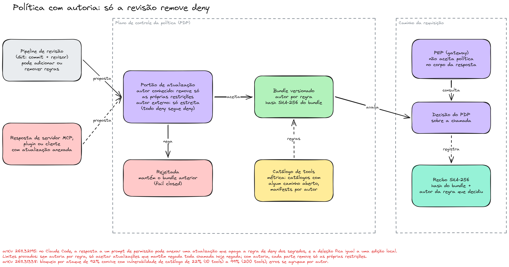

# Digest — IA, ML e dados · 25 nov 2026 (quarta)

## O que prestar atenção hoje

- No gateway de contexto, quem pode responder a um pedido de permissão pode acabar administrando a política. O trabalho sobre o Claude Code (arXiv 2611.32195) mostra que a resposta a um prompt pode anexar uma atualização que apaga a regra de deny que protege segredos, e que a deleção fica registrada igual a uma edição local do operador. A regra provada pelos autores é simples: se o runtime não sabe quem escreveu cada regra, só aceita atualizações que mantêm negado tudo o que já estava negado. No mesmo dia, o arXiv 2611.31338 mostra que bloquear 92% dos ataques por ataque convive com 99% de catálogos vulneráveis com 200 tools.
- Em roteamento, o custo de decidir já é quase o custo de fazer. No arXiv 2611.32365, o roteamento de controle de fluxo é 42,5% do custo de referência na tarefa inicial, e entregar as ações finitas a um modelo de decisão especializado (o Jev) corta o custo médio em 49,6% (IC 95% de 42,9% a 56,3%). O TableRouter (arXiv 2611.32006) faz a mesma divisão do lado do contexto: rota de cálculo sobre a tabela inteira ou rota de cobertura com linhas recuperadas.
- Na orquestração de dados, o Airflow ainda não faz backfill de DAG agendada por asset particionado: `airflow backfill create` rejeita `PartitionedAssetTimetable`. O AIP-129, em discussão, propõe reprocessar partições do consumidor a partir dos eventos de asset já gravados, sem rodar os produtores de novo. Em 24/11 entrou no main a correção de uma condição de corrida que fazia o scheduler avaliar o `DeadlineReference` errado.

## 1. Responder a um pedido de permissão vira administrar a política, e o catálogo inteiro é o elo fraco (arXiv 2611.32195 e 2611.31338)

- **O que é.** Agentes de código deixam plugins e serviços remotos responderem a prompts de permissão. O Claude Code documenta que essa resposta não sobrepõe as regras de deny do operador, mas o arXiv 2611.32195 (24/11) mostra que a garantia, checada uma decisão por vez, falha ao longo da execução: a resposta a um prompt pode reescrever a política contra a qual todas as respostas seguintes são checadas. No exemplo, um serviço remoto sem acesso aos arquivos aprova um comando qualquer e anexa uma atualização que apaga a regra que protegia os segredos do projeto, e o agente lê os segredos nessa sessão e na seguinte, mesmo no sandbox estrito.
- **Como funciona.** A causa é que o Claude Code só checa atualizações que adicionam ou substituem regras de allow. A deleção deixa os mesmos registros de uma edição local, então o runtime não sabe quem escreveu a regra. Os autores provam dois limites justos: sem autoria registrada, o runtime só pode aceitar atualizações que mantêm negada toda chamada hoje negada; com autoria por regra, cada parte pode remover só as restrições comprovadamente suas. Os limites previram se as restrições do operador sobrevivem em 13 desenhos de permissão de 10 sistemas de agentes (inclusive Codex, Gemini CLI, opencode e Goose, previstos antes de rodar), e aplicá-los no passo de atualização bloqueia o ataque. De 2.227 plugins de marketplace, só dois mandam atualizações de política.
- **O catálogo como unidade.** O arXiv 2611.31338 (23/11) mostra que medir bloqueio por ataque esconde a vulnerabilidade do catálogo de manifests de tools: com M políticas escritas de forma independente, cada uma errada com probabilidade p, a chance de existir um caminho de exfiltração aceito é 1-(1-p)^M. Em catálogos sintéticos no ChainCaps e no OpenAPPA, o bloqueio por ataque fica em 92% enquanto a vulnerabilidade do catálogo vai de 22% com 10 tools a 99% com 200. Os erros se agrupam por autor (um catálogo de 200 tools se comporta como cerca de 5 decisões independentes, IC 95% de 3,4 a 9,2), e em 114 tools MCP reais os manifests escritos pelos modelos bloqueiam 89% dos ataques e deixam 9 de 15 catálogos abertos.
- **Para o gateway de contexto.** O bundle de política do PDP precisa registrar o autor de cada regra (commit e revisor no Git) e o passo de atualização precisa ser monotônico: atualização que vem de fora do pipeline de revisão só pode estreitar, nunca remover deny, e qualquer outra é rejeitada mantendo o bundle anterior (fail closed). O PEP não aceita política vinda no corpo de resposta de servidor MCP ou de cliente. No recibo SHA-256 entram o hash do bundle e o autor da regra que decidiu. Para o catálogo de tools, a métrica de teste deixa de ser "% de ataques bloqueados" e passa a ser "catálogos com algum caminho aberto", contando os manifests por autor.
- Fontes: https://arxiv.org/abs/2611.32195 · https://arxiv.org/abs/2611.31338

## 2. Recibos que fecham a conta e recuperação que causa dano (arXiv 2611.31806 e 2611.31554)

- **TokenProv (24/11).** Contas de tokens chegam com pouca evidência de quais chamadas geraram a cobrança; em fluxos de agentes com broker, as chamadas surgem depois da autorização e a evidência atravessa domínios. O TokenProv usa aceites autenticados do provedor para provar cobertura: uma história causal autenticada liga as tentativas à política assinada, e handoffs assinados em conjunto amarram intenção, despacho e aceite à mesma chamada. Handoffs enviados independentemente da conta revelam chamadas omitidas, e o auditor exige casamento um a um entre aceites observáveis e recibos liquidados. Com recibos assinados do provedor, a vazão fica entre 94,4% e 107,4% da linha de base, com 54 a 66 ms de processamento online por requisição; adiar as provas reduz o tempo de protocolo de 1,20 s para 8,65 ms num replay de oito chamadas, e o auditor rejeita as 1.600 consultas de ataque validamente assinadas.
- **Recuperação que causa dano (23/11).** Em trajetórias gravadas do AppWorld com dez modelos, 145 de 200 episódios amostrados são execuções parciais confirmadas pelo estado do banco, e 30 de 143 com desfecho determinável terminam numa recuperação danosa (estimativa ponderada de 24,6%). Dois terços duplicam um efeito; o resto apaga dados ou faz uma primeira escrita errada. Uma regra que procura chamadas repetidas acha 75% das duplicações, mas só 41% do dano. Identificador de operação fornecido pelo modelo não reduziu dano no piloto, porque o modelo gera um identificador novo para a mesma operação.
- **Para o gateway de contexto.** O recibo SHA-256 já registra a decisão; o TokenProv sugere encadear três eventos por chamada (decisão do PDP, despacho do PEP, aceite da fonte ou do provedor de modelo) e reconciliar com a fatura do provedor por call ID. Em brains só de leitura, o risco de dano é baixo, mas a lição do segundo trabalho vale para o PDP: chave de idempotência derivada do conteúdo da chamada canônica, não do modelo.
- Fontes: https://arxiv.org/abs/2611.31806 · https://arxiv.org/abs/2611.31554

## 3. Modelo de decisão no controle de fluxo e rota por tipo de evidência (arXiv 2611.32365 e 2611.32006)

- **Control-Flow Tax (24/11).** Num fluxo de documentação, o roteamento de controle de fluxo é 42,5% do custo de referência na tarefa inicial, e roteadores genéricos baratos não resolvem, porque podem disparar chamadas extras ao gerador caro. Os autores avaliam uma arquitetura em que o Jev, um modelo de decisão de "Sistema 1", controla as ações finitas e o Sol gera os documentos. Em quatro tarefas (480 execuções válidas, 470 completas), o roteamento todo pelo Jev tem o menor custo médio e o menor tempo em todas; na tarefa inicial, o custo médio cai 49,6% (IC 95% de 42,9% a 56,3%) e o tempo 33,2% (de 19,6% a 46,7%), e nas outras três o custo cai de 40,5% a 42,9%. Especializar só a checagem de existência economiza 1,8%. Em 100 estados de varejo revisados, Sol e Jev escolhem ações aceitas em 100, com o Jev usando 97,88% menos custo de referência.
- **TableRouter (24/11).** Quando a tabela não cabe no contexto, recuperar linhas resolve só parte: o subconjunto pode omitir o que um agregado exato precisa. O TableRouter analisa cada pergunta e escolhe entre a rota de cálculo (estatísticas condicionadas à pergunta sobre a tabela inteira) e a rota de cobertura (linhas relevantes e resumos de coluna), numa única chamada a um LLM congelado. Supera o melhor de seis baselines em nove de nove cenários, por 1,2 a 18,3 pontos, com 77% a 95% menos FLOPs estimados; dar as estatísticas calculadas melhora em até 40,0 pontos mesmo com todas as linhas da resposta disponíveis.
- **Para quem monta brains analíticos.** As duas peças encaixam no roteamento do gateway: um modelo de decisão barato escolhe entre opções finitas (métrica, documentos, grafo ou escalar), e a rota "cálculo" é a dbt Semantic Layer, não linhas cruas. O resultado do TableRouter reforça que pergunta de agregado vai para a métrica calculada, mesmo quando o retriever acharia as linhas. Para um caso de risco de crédito, a mesma regra vale para "quantos", "quanto" e "evolução de": rota de cálculo por padrão.
- Fontes: https://arxiv.org/abs/2611.32365 · https://arxiv.org/abs/2611.32006

## 4. MCP: eventos que chegam a todas as réplicas, chave do gateway e servidor que vira canal de anúncio (FastMCP 4.2.6 e LiteLLM v1.111.0, 24/11)

- **FastMCP 4.2.6 (24/11, 21h40 BRT).** A extensão experimental de Events virou o pacote `fastmcp-events`, com API nova: cada tipo de evento é um modelo Pydantic registrado com `@events.event("name")`, alimentado por `await events.emit(...)` ou por um reader, e um método opcional `for_subscription` decide o que cada assinatura recebe. Com `DocketEventLog` (extra `fastmcp-events[docket]`), os eventos ficam no Redis e sobrevivem a restarts e chegam a todas as réplicas. A versão traz também o `CodeModeClient` experimental, que roda o code mode no cliente sobre servidores que não o implementam (meta-tools de busca, schema e execute, encadeando tools de vários servidores num bloco), atributos `network.transport` e `network.protocol.*` nos spans, e o Authlib deixou de ser dependência.
- **LiteLLM v1.111.0 (24/11, 22h42 BRT).** Entre as mudanças do gateway MCP, a que quebra compatibilidade é encaminhar a chave do LiteLLM ao servidor upstream quando o admin configura; a listagem de um único servidor passa a devolver challenge quando o upstream rejeita a credencial, e grants de escopo separados por vírgula são aceitos. No roteador, um retry pode sair de um deployment fixado depois de falha retentável, os limites por modelo são rechecados nos alvos de fallback, e o gasto com guardrails aparece separado no relatório diário.
- **Na comunidade.** Em r/ClaudeAI (24/11, 500 pontos e 37 comentários) e r/mcp (18 pontos), usuários relatam que o servidor MCP hospedado da Notion, ao atingir a cota horária de consultas SQL em `notion-query-data-sources`, injeta via priming do schema da tool e um bloco `client_guidance` um "Try it free" disfarçado do plano Business na resposta do agente, em clientes e modelos diferentes. Em r/mcp (24/11, 15 pontos e 13 comentários), outro relato de caracteres Unicode de largura zero num campo de formulário sequestrando um agente MCP com escopo, e a resposta prática de sanitizar zero-width, controles bidi e o bloco Unicode Tags na tool. https://www.reddit.com/r/ClaudeAI/comments/1y4pxfl/3_months_after_getting_called_out_here_notions/ · https://www.reddit.com/r/mcp/comments/1y4aqvc/notions_official_mcp_server_uses_toolschema/ · https://www.reddit.com/r/mcp/comments/1y46vmz/zero_width_unicode_in_a_form_field_just_hijacked/
- **Para o gateway de contexto.** Para a extensão Events (digest de 23/11), o 4.2.6 resolve o problema de réplica apontado em 24/11: com o Docket, um PDP com várias réplicas recebe o evento. As notas do 4.2.6 não dizem que o `listChanged` passou a atravessar réplicas, então a releitura periódica de `tools/list` segue necessária. O caso da Notion é o padrão do "Ads for Agents" (24/11) num fornecedor grande: campos como `client_guidance` e texto adicional no resultado vão para o recibo com hash e são removidos antes do modelo, e o retorno de servidor de terceiro passa por normalização Unicode no PEP (remover zero-width, bidi e Tags) antes da checagem de política. Se o LiteLLM ficar como roteador de modelos atrás do PDP, a chave dele não pode ir para servidores MCP de terceiros.
- Fontes: https://github.com/PrefectHQ/fastmcp/releases/tag/v4.2.6 · https://github.com/BerriAI/litellm/releases/tag/v1.111.0

## 5. Embedding como ponto cego e vazamento semântico (arXiv 2611.31344 e 2611.32610)

- **EON (23/11).** Em sistemas de retrieval agêntico, o embedding denso decide que intenção, tool, documento, memória ou imagem recuperar. O trabalho mostra que uma consulta com sentido pode ser trocada por conteúdo visivelmente sem sentido (Embedding-Optimized Noise) que preserva boa parte do resultado, construído só a partir da representação da consulta natural, sem acesso aos embeddings dos candidatos, rótulos, rankings ou decisões de guardrail. Os EONs preservam roteamento de intenção e de tool, busca de documentos, recuperação de memória episódica e busca cross-modal em várias famílias de embeddings, e, para consultas maliciosas, passam por guardrails de entrada que bloqueiam a versão natural.
- **PDC-Bench (24/11).** Formaliza o controle de divulgação como um teto permitido na hierarquia de um grafo de conhecimento (por exemplo, localização só no nível de país; dizer o estado já viola). São 16.105 amostras em geografia, idade, raça e etnia e ocupação; em onze LLMs, 62% das violações foram vazamento semântico, e ele depende menos do modelo que da granularidade permitida e de quanto a tarefa precisa do atributo.
- **Para quem monta brains analíticos.** Se o PDP ou o roteador decide rota por similaridade de embedding, um guardrail que lê só o texto da pergunta não basta: a checagem tem de valer sobre o que foi recuperado e sobre a rota escolhida, e consulta com baixa "legibilidade" (proporção de tokens sem sentido) deve ser negada antes do retriever. O PDC-Bench dá uma forma testável de princípio da necessidade na LGPD: direito expresso como nível máximo na hierarquia (entidade, grupo, setor, região) e teste de saída que procura o nível acima do permitido, não só o valor exato.
- Fontes: https://arxiv.org/abs/2611.31344 · https://arxiv.org/abs/2611.32610

## 6. GraphRAG com um salto planejado em SPARQL e rerank de "Sistema 1" (arXiv 2611.31771 e 2611.32917)

- **SPARQL planejado, não executado (24/11).** Em multi-hop, expandir vários saltos no grafo depois da busca melhora o recall, mas custa e traz ruído. O trabalho intercala busca densa com travessia de um grafo de conhecimento externo (Wikidata): a busca densa acha as primeiras regiões relevantes, e a travessia confirma as passagens contra um caminho de raciocínio no grafo. Um LLM planeja a travessia como uma consulta SPARQL, que é parseada em vez de executada. Com a mesma configuração e o mesmo leitor em 1.000 perguntas por base: 62,5/75,1 EM/F1 no HotpotQA, 73,5/81,0 no 2WikiMultiHopQA e 37,1/50,0 no MuSiQue, à frente do HippoRAG2, T²RAG e IRCoT reproduzidos. Executar o SPARQL gerado custa até 11,4 pontos de EM, principalmente porque consultas cruas voltam vazias, não por erro de sintaxe.
- **SOARS (24/11).** Rerankers melhoram o retrieval mas custam latência quando chamados em toda a trajetória de um agente de busca. O SOARS usa um modelo de "Sistema 1" para estimar relevância calibrada: a cada passo, seleciona trechos relevantes de documentos longos e reordena os candidatos numa só chamada, considerando a pergunta original e a subconsulta do agente. No BrowseComp-Plus, a acurácia do GPT-5.4 Mini sobe de 73,9% para 84,7% e as buscas caem de 23 para 14.
- **Para quem monta brains analíticos.** Na ontologia como código, o plano de travessia gerado pelo LLM pode ser validado contra a ontologia (classes e relações existentes) e usado como filtro de passagens, sem executar consulta livre no grafo, o que também evita uma superfície de injeção. O número de 11,4 pontos perdidos ao executar é um argumento a favor de "parsear e conferir" em vez de "executar o que o modelo escreveu". O SOARS mostra onde o rerank cabe no orçamento: uma chamada barata por passo, não um cross-encoder em cada busca.
- Fontes: https://arxiv.org/abs/2611.31771 · https://arxiv.org/abs/2611.32917

## 7. Memória e contexto: utilidade em vez de fidelidade, evidência suficiente e compactação que perde procedência (arXiv 2611.33005, 2611.32088 e 2611.31668)

- **Leto (24/11).** Trata a memória do agente como problema de previsão: o valor está em melhorar a resposta futura, não em ser fiel à conversa. Mantém acesso aos detalhes por indexação das fontes, faz "replay" para antecipar o contexto que a requisição não pede explicitamente e usa o desfecho das respostas num loop que ajusta a seleção. Supera o melhor de seis sistemas em 16,3 pontos no PrefEval e 3,1 no PERMA, e empata com retrieval sobre o histórico bruto em contexto longo servindo menos tokens.
- **BiDE-Mem (24/11).** Relevância não garante evidência suficiente: a resposta precisa de um conjunto de registros que satisfaça juntos as restrições factuais, relacionais, temporais e de estado. O trabalho representa a pergunta como demandas tipadas que guiam retrieval e organização da evidência com procedência; ganha 6,23 pontos sobre o Mnemis no LoCoMo e chega a 91,80% no LongMemEval.
- **Compactação multilíngue (23/11).** Assistentes compactam mensagens antigas em notas e descartam os originais. Quando a língua da nota exige uma distinção que a mensagem não fez (gênero de adjetivo em espanhol), a nota inventa ou apaga um atributo; após o descarte, o recall de atributos declarados cai de 90% para 34%. A correção sem treino (formas pareadas para o não dito, checagem antes do descarte) sobe o F1 de 9 a 53 pontos em QA.
- **Para quem monta brains analíticos.** O BiDE-Mem dá o formato para o PDP checar suficiência, não só relevância: para "saldo em atraso do cliente X no trimestre", as demandas são entidade, período e estado, e a rota que não cobre as três responde com abstenção. A compactação é um risco direto em português: resumo de histórico de conversa pode afirmar o que o usuário não disse, e o resumo deve guardar o hash e o ponteiro das mensagens originais em vez de descartá-las.
- Fontes: https://arxiv.org/abs/2611.33005 · https://arxiv.org/abs/2611.32088 · https://arxiv.org/abs/2611.31668

## 8. Text-to-SQL com conhecimento consultável e códigos descritos num grafo (arXiv 2611.32772 e 2611.32646)

- **RubikSQL-HB (24/11).** Expõe significados de negócio, valores armazenados e consultas de referência como workspaces de conhecimento consultáveis por banco, que o agente usa enquanto monta e executa o SQL; um Judge reaproveita as mesmas interfaces para investigar divergências entre candidatos. No BIRD Mini-Dev (500 perguntas), chega a 75,2% de acurácia de execução, contra 71,2% escolhendo o primeiro candidato e 70,4% por voto de execução; há candidato correto em 79,0% das perguntas, e a versão sem o workspace construído fica 3,0 pontos abaixo.
- **LOCuST (24/11).** Benchmark de text-to-SQL para estatísticas oficiais: mais de 2.000 tabelas largas em inglês e holandês do Statistics Netherlands, com colunas e valores codificados cujo significado está num grafo de conhecimento semântico (rótulos, definições, hierarquias e unidades). Os LLMs avaliados têm dificuldade em escrever SQL correto; o trabalho propõe um F1 de observações que mede proximidade mesmo quando a resposta difere.
- **Para quem monta brains analíticos.** Os dois apontam para o mesmo desenho: o significado de códigos (modalidade, setor, faixa de atraso) fica fora do schema, num artefato versionado que o agente consulta durante a geração, e correções recorrentes viram checagens de execução. É o papel da ontologia em Git com MCP ao lado da Semantic Layer; o LOCuST é um bom molde para um conjunto de teste de text-to-SQL com tabelas largas e códigos.
- Fontes: https://arxiv.org/abs/2611.32772 · https://arxiv.org/abs/2611.32646

## 9. Orquestração: backfill por partição de asset, prazo de negócio que avaliava a referência errada e o que mudou em Databricks, Astronomer e Prefect (24/11)

- **Airflow, AIP-129 (em discussão, atualizado em 20/11).** Desde o 3.2, uma DAG com timetable periódico particionado faz backfill de uma execução por partição, mas uma DAG agendada por assets particionados (`PartitionedAssetTimetable`) é rejeitada pelo `airflow backfill create` com `DagNonPeriodicScheduleException`. A proposta deixa o consumidor ser alvo de backfill por intervalo de datas ou lista de chaves, com no máximo uma execução por chave por pedido, lendo os eventos de asset que já existem, sem rodar produtores. Vale para rollups de calendário e consumidores com `IdentityMapper`; se as datas de partição dos insumos não concordam, a chave fica sem execução com motivo `no single partition date`. O agendamento normal continua independente e pode criar outra execução para a mesma chave, que é a principal questão em aberto. Há um PR de prova de conceito em rascunho (#77152).
- **Airflow, Deadline Alerts (main, 24/11, 15h31 BRT).** Com duas `DeadlineReference` customizadas de mesmo nome de classe, a primeira parseada era sobrescrita em silêncio e o scheduler avaliava a errada, dependendo da ordem de import a cada restart. Agora nenhuma das duas fica com o atalho `DeadlineReference.<Nome>`, um warning cita as duas pelo nome qualificado, nome que colide com um embutido (como `DAGRUN_QUEUED_AT`) gera erro e o re-registro substitui a entrada em vez de duplicar. Também em 24/11 entrou o `DatabricksGenieOperator` deferrable e retomável (com `durable=True` no Airflow 3.3+, um retry reconecta à mensagem em andamento), e o backport no 3.4 da correção do nome de watcher errado em assets que compartilham o mesmo trigger.
- **Databricks e ferramentas.** A conversão do Genie Migrate de scripts T-SQL (SQL Server e Synapse) para pipelines Lakeflow em Spark Declarative Pipelines entrou em GA (24/11): cada grupo de arquivos vira um pipeline serverless validado com dry run. O Databricks CLI v1.28.0 (24/11) faz `bundle run` e `pipelines run` repetirem leituras transitórias de status em vez de falhar e corrige o travamento de comandos de bundle após timeout numa conexão HTTP/2 morta. O astro-cli 1.48.0 (24/11) permite deploys de dbt e de bundles que não são DAG a partir do diretório do projeto Astro. O Prefect 3.9.5 (24/11) indexa nomes exatos de recursos relacionados para acelerar o casamento de event triggers. No Snowflake (20/11), `INSERT OVERWRITE ... DELETING WHERE` apaga e insere numa só instrução, também em Dynamic Tables com incrementalização customizada, para recomputar uma janela recente com dados atrasados.
- **Para quem migra a orquestração.** O AIP-129 é o ponto que falta para trocar uma malha de `ExternalTaskSensor` por assets particionados sem perder o backfill: hoje, quem usa `PartitionedAssetTimetable` reprocessa uma partição só rodando o produtor de novo ou criando eventos pela API. Até ele sair, uma opção é deixar o reprocessamento por partição na plataforma de execução (por exemplo, Lakeflow Jobs com a task de dbt e a partição como parâmetro) e o Airflow só na fronteira. Quem expressa prazo de negócio com Deadline Alerts precisa de nomes de `DeadlineReference` únicos no ambiente; a correção está no main e ainda não saiu em release. Para o `as_of` de brains analíticos, a regra do AIP (sem execução quando as datas de partição dos insumos não concordam) é a mesma que um gateway de contexto deveria aplicar: sem `as_of` único entre as fontes, a resposta sai marcada ou não sai.
- Fontes: https://cwiki.apache.org/confluence/spaces/AIRFLOW/pages/462817309/AIP-129+Backfill+for+Asset+Consumers+with+Dated+Partitions · https://github.com/apache/airflow/pull/77152 · https://github.com/apache/airflow/pull/73299 · https://github.com/apache/airflow/pull/76157 · https://docs.databricks.com/aws/en/release-notes/product/2026/november · https://github.com/databricks/cli/releases/tag/v1.28.0 · https://github.com/astronomer/astro-cli/releases/tag/v1.48.0 · https://github.com/PrefectHQ/prefect/releases/tag/3.9.5 · https://docs.snowflake.com/en/release-notes/2026/other/2026-11-20-insert-overwrite-deleting-where

## 10. Dados: várias row access policies por tag e embeddings no BigQuery (Snowflake 23/11, BigQuery 24/11)

- **Snowflake (23/11, Preview).** Uma tabela ou view pode ter várias row access policies baseadas em tag. Por padrão elas se combinam com AND; para OR, a política é definida na tag com `PERMISSIVE`.
- **BigQuery (Google, 24/11).** O modelo embutido `embeddinggemma-300m` em `AI.EMBED` e `AI.SIMILARITY` entrou em GA. O BigQuery Migration Service passou a traduzir Databricks SQL e Spark SQL 3.x e 4.x para GoogleSQL e a extrair metadados de schema do Databricks (Preview).
- **Para quem monta brains analíticos.** O AND padrão é o comportamento seguro quando a mesma tabela recebe restrição por carteira e por classificação LGPD; `PERMISSIVE` alarga o acesso e deve passar pela mesma revisão de política que o PDP. O recibo precisa registrar quais políticas de linha valiam na consulta, porque a combinação muda o resultado.
- Fontes: https://docs.snowflake.com/en/release-notes/2026/other/2026-11-23-multiple-tag-based-row-access-policies · https://cloud.google.com/bigquery/docs/release-notes

## Diagrama

Atualização de política com autoria: o pipeline de revisão em Git é o único caminho que remove deny; atualização vinda de resposta de servidor, plugin ou cliente só pode estreitar, e o recibo cita o hash do bundle e o autor da regra que decidiu. Editável: [2026-11-25-politica-com-autoria.excalidraw](../../assets/2026-11-25-politica-com-autoria.excalidraw).

## Repos em alta

- **INK-Q/agy-fast** (MIT, criado em 19/11/2026, 1.394 stars pela API do GitHub em 25/11): plugin MCP local, sem dependências de runtime, para o Google Antigravity (CLI, Desktop e IDE). Consolida buscas frequentes, outlines de símbolos, edições atômicas em vários arquivos e checagens de build e teste em chamadas locais em lote e injeta um snapshot do workspace uma vez por sessão; o README reporta 34% menos turnos de LLM (número do autor). Para o gateway, é mais um exemplo de que juntar várias tool calls numa chamada local corta turnos, o mesmo argumento do code mode e do `CodeModeClient` do FastMCP 4.2.6: https://github.com/INK-Q/agy-fast
- **bl8ds/AgentDesk-Private-Deployable-Knowledge-Base-Agent-Platform** (MIT, criado em 20/11/2026, 96 stars pela API do GitHub em 25/11): implementação de referência sobre Mastra de base de conhecimento RAG com agente, implantável em rede privada (PostgreSQL com pgvector, Redis, object storage). Upload, chunking e embedding assíncronos, Q&A em streaming com citação da fonte, recusa automática sem base de retrieval, OIDC/JWKS, RBAC, cotas e log de auditoria num backend em Go, e redação de termos sensíveis durante o streaming SSE. Para quem monta brains analíticos, é um checklist de produto (recusa sem evidência, redação no stream, auditoria por pergunta) para comparar com o que um gateway de contexto cobre: https://github.com/bl8ds/AgentDesk-Private-Deployable-Knowledge-Base-Agent-Platform
- **gogoymh/git-ontology-agent** (MIT, criado em 21/11/2026, 33 stars pela API do GitHub em 25/11): cada pedido do usuário vira um branch Git, e uma ontologia de claims tipados (Request, Constraint, Assumption, Finding, Decision, Progress, com `from`, `depends_on` e `status`) decide o que refazer quando chega um complemento e como fazer o merge, com regras por tipo. Um modelo de decisão separado julga a relação entre o novo pedido e o que está em andamento, e cada resultado é rastreável ao pedido que o gerou. Para quem versiona ontologia, é um exemplo pequeno (Python, sem dependências) de ontologia em Git com procedência por claim: https://github.com/gogoymh/git-ontology-agent

## Para aprofundar

- Periplus (arXiv 2611.31679): índice hierárquico em texto puro, inspirado na B+ tree, de resumos gerais na raiz a específicos nas folhas, com a estrutura descoberta pelo LLM por documento e navegação pela relevância do resumo. Em narrativas e contratos fica a 0,1 a 0,9 ponto do melhor baseline com 70% a 72% menos tokens, e não depende de um modelo de embedding: https://arxiv.org/abs/2611.31679
- KuroANN (arXiv 2611.32908): busca vetorial filtrada em SSD que define as leituras de cada consulta pelo número de vetores que passam no filtro, conhecido antes da busca; até 34,5x sobre o PipeANN-Filter e 9,10x sobre o Faiss. Relevante para busca com filtro de direito por carteira: https://arxiv.org/abs/2611.32908
- Exactly-once em pipelines de pagamento (arXiv 2611.31298): a cobrança dupla depois de um restart depende de comparar quanto tempo o provedor lembra a chave de idempotência com quão velho um registro pode estar ao ser reprocessado, número montado a partir de intervalo de checkpoint, runbook, atraso de restart e limite de atraso da fonte; no corpus de 630 pipelines gerados, 210 não podem ser derivados de menos de três artefatos. Vale para backfill e reprocessamento: https://arxiv.org/abs/2611.31298
- PIEQ (arXiv 2611.32032): camada de certificação que deixa os LLMs fora da base de computação confiável e cai para sondas só de leitura sob ambiguidade, com zero admissões inseguras dentro das premissas; benchmarks rotulados pelos autores: https://arxiv.org/abs/2611.32032
- No r/AI_Agents (24/11, 11 pontos e 24 comentários), a thread "How do you test whether an AI assistant can tell a task is already finished?" sugere manter um ticket por tarefa em vez de inferir o estado pela conversa: https://www.reddit.com/r/AI_Agents/comments/1y4ll4q/how_do_you_test_whether_an_ai_assistant_can_tell/
