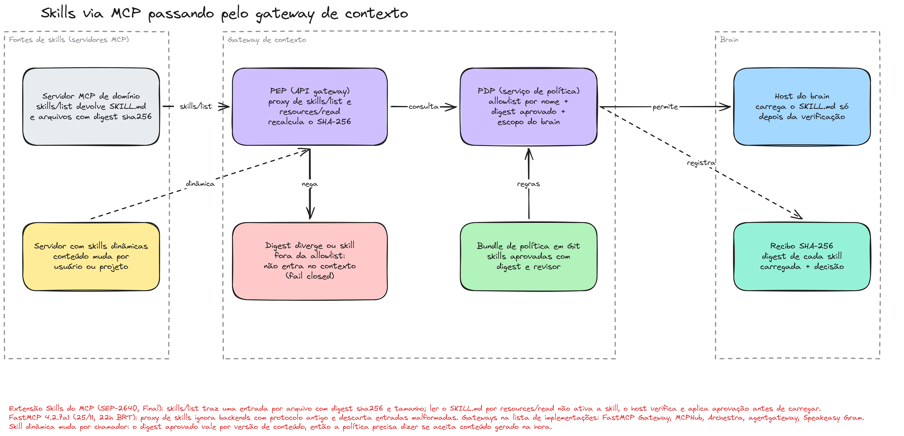

# Digest — IA, ML e dados · 26 nov 2026 (quinta)

## O que prestar atenção hoje

- No gateway de contexto, o próximo tipo de contexto a governar são as instruções, não só os dados. A extensão Skills do MCP (SEP-2640, Final) serve `SKILL.md` e arquivos de apoio por `skills/list` com digest `sha256` por arquivo, e os gateways começam a fazer proxy disso: o FastMCP 4.2.7a1 (25/11, 22h00 BRT) endurece o proxy de skills, a documentação nova mostra skills que mudam por usuário autenticado, e a lista oficial de implementações já tem uma seção de gateways (FastMCP Gateway, MCPHub, Archestra, agentgateway, Speakeasy Gram). Skill é contexto que entra no modelo e precisa da mesma allowlist por digest e do mesmo recibo que um documento.
- Gateway que é opcional não governa. A Microsoft passou a rotear tools MCP do Foundry Agent Service pelo AI Gateway ou pelo API Management (preview, 24/11), mas deixou de registrar a rota sozinha: tool configurada com o endpoint direto continua chamando o servidor direto. No mesmo dia, o Zenity MCP Gateway entrou em GA com identidade por chamada, política inline e kill switch por servidor. E o arXiv 2611.33605 mostra o outro buraco: o agente que se recupera de uma falha pode cumprir a tarefa por um desvio que descarta a proteção exigida pelo fluxo original.
- Na orquestração de dados, DAG agendada por assets que acumula eventos pode falhar antes de começar: com 33.500 eventos na fila, o `ti_run` do Airflow levava de 11 a 22 s, acima do timeout de 5 s da Execution API, e a task caía. A correção (`selectinload`, 4,4 s no mesmo cenário) entrou no ramo `v3-4-test` em 25/11. É exatamente o padrão `schedule=[Asset("raro"), Asset("frequente")]` que aparece quando a malha horária vira gatilho de dado.

## 1. Skills sobre MCP chegam aos gateways: instrução com digest, proxy e conteúdo por chamador (FastMCP 4.2.7a1 e ext-skills, 24–25/11)

- **O que é.** A extensão oficial `io.modelcontextprotocol/skills` (SEP-2640, status Final, mantida pelo Skills Over MCP Working Group) deixa um servidor MCP expor workflows como diretórios com `SKILL.md` e arquivos de apoio, no formato Agent Skills. O cliente descobre por `skills/list` e `skills/get` e lê o conteúdo pelo primitivo Resources (`resources/read`, e `resources/directory/read` quando o servidor declara `directoryRead`). A extensão já está no TypeScript SDK v2.4.0, no C# SDK v2.4.0, no rmcp 3.9.0, no Ruby SDK v1.9.0 e no FastMCP 4.2.0; no Python SDK oficial está mergeada, sem release.
- **Como funciona.** Cada entrada de `skills/list` traz, por arquivo, a URI, o digest `sha256:` e o tamanho, além de `ttlMs` e `cacheScope` para cache. A especificação separa leitura de ativação: ler o `SKILL.md` por `resources/read` não ativa a skill; o host passa a leitura pelo seu caminho de carga, que verifica o conteúdo e aplica a aprovação do usuário antes de pôr no contexto do modelo. O FastMCP 4.2.7a1 (25/11, 22h00 BRT) faz o proxy de skills pular backends com versão antiga do protocolo, descartar entradas malformadas sem derrubar a lista e sanitizar os avisos de validação. A documentação mergeada em 25/11 (21h21 BRT) mostra skills dinâmicas: um `SkillCatalogProvider` monta instruções ou arquivos a partir de dados atuais e escolhe quais skills expor ao chamador autenticado, e a mesma URI pode servir uma tabela de roteamento diferente por projeto. A lista de implementações (atualizada em 24 e 25/11) traz o FastMCP Gateway (hospedado, permissões por skill), o MCPHub (desde v1.3.0, endpoints globais e por grupo, passa a suíte de conformidade), o Archestra (parcial, sem `ttlMs`/`cacheScope` no `skills/get`), o agentgateway (pass-through mergeado, sem release) e o Speakeasy Gram (atrás de flag, só `SKILL.md`).
- **Para quem monta um gateway de contexto.** Skill é instrução que entra no modelo, então passa pelo mesmo caminho que um documento recuperado. O PEP faz o proxy de `skills/list` e `resources/read`, recalcula o SHA-256 de cada arquivo e compara com o digest anunciado; o PDP só libera skill cujo nome e digest estejam no bundle de política revisado em Git, dentro do escopo do brain. Digest divergente, skill fora da allowlist ou servidor sem a extensão: a skill não entra no contexto (fail closed). Skill dinâmica muda por chamador e quebra a ideia de digest aprovado por versão; a política precisa dizer se aceita conteúdo gerado na hora e, se aceitar, o recibo SHA-256 guarda o digest efetivamente carregado, a identidade do chamador e a decisão.
- **Na comunidade:** no r/mcp (25/11, 110 pontos e 43 comentários), a thread "Anthropic just announced Skills over MCP" separa as duas ideias: converter definições de tools em skills para economizar contexto não é o mesmo que o autor do servidor escrever o passo a passo de uso das tools junto com o serviço: https://www.reddit.com/r/mcp/comments/1y4utyx/anthropic_just_announced_skills_over_mcp_i_built/
- Fontes: https://modelcontextprotocol.io/extensions/skills/overview · https://github.com/PrefectHQ/fastmcp/releases/tag/v4.2.7a1 · https://github.com/PrefectHQ/fastmcp/pull/6829 · https://github.com/modelcontextprotocol/ext-skills/blob/main/docs/implementations.md

## 2. Gateway de MCP opcional não governa: Foundry, Zenity e o Apigee hybrid 1.15.11 (24/11)

- **Microsoft Foundry (preview, 24/11).** O Foundry Agent Service pode mandar o tráfego de tools MCP pelo AI Gateway ou pelo Azure API Management, com rate limit, filtro de IP, correlation ID e roteamento por header em política XML, e telemetria da chamada e do resultado da política no gateway. A mudança importante está na limitação: o Foundry não registra mais o servidor MCP no gateway nem reescreve o endpoint, e tools já existentes não passam a ser mediadas; quem configurou o endpoint direto continua chamando o servidor direto. O mesmo pacote trouxe orçamento de gasto ou tokens por recurso e projeto (alerta ou bloqueio, ainda estimado e só para deployments Azure OpenAI) e controle de domínios de saída por Azure Policy, que é o que torna o gateway obrigatório.
- **Zenity MCP Gateway (GA, 24/11).** Hospedado entre agentes e servidores MCP, com credenciais centralizadas, identidade do usuário por chamada via IdP, política inline avaliada em toda chamada, bloqueio de sequências de chamadas arriscadas e kill switch que corta um servidor para todos os clientes. A política combina quem pede com a agência da tool (read-only, mutativa, destrutiva), e o servidor pode ser governado pela URL de destino, que não muda quando o nome muda.
- **Apigee hybrid v1.15.11 (24/11).** Entre as correções: sessões de debug podiam mostrar payloads, query parameters, headers ou variáveis de fluxo sem máscara quando outra sessão ou um erro de máscara interferia; respostas `text/event-stream` comprimidas num proxy com EventFlow voltavam corrompidas e agora passam direto sem processamento de EventFlow; e uma falha de validação de `redirect_uri` do OAuth 2.0 em casamento não estrito foi fechada.
- **Para quem monta um gateway de contexto.** O desenho certo é o que o Foundry deixa explícito pela falta: o PEP só governa se for o único caminho de saída. Os brains não devem ter rota de rede direta para servidores MCP ou fontes; a regra de egress é parte do gateway, e o PDP deve tratar "chamada que não veio pelo PEP" como violação auditável. A ideia do Zenity de governar pela URL de destino vale para o bundle de política (identificador estável do servidor, não o nome). Na nota do Apigee, as duas correções que tocam o desenho são a máscara em debug, porque trace de debug com payload sem máscara é vazamento de dado pessoal, e o EventFlow com SSE comprimido, que afeta resposta em streaming; quem usa Apigee X deve conferir as notas equivalentes da sua versão.
- Fontes: https://learn.microsoft.com/en-us/azure/foundry/agents/how-to/tools/governance · https://ipaas.it/en/blog/microsoft-foundry-mcp-gateway-a2a-cost-controls/ · https://zenity.io/blog/announcing-zenity-mcp-governance-gateway · https://cloud.google.com/apigee/docs/release-notes

## 3. Recuperação que rebaixa a segurança e política que aprende errado (arXiv 2611.33605 e 2611.33385)

- **Workflow security downgrade (25/11).** Agentes que usam tools e Skills replanejam sozinhos quando uma operação falha, e a recuperação pode manter a tarefa funcionando enquanto descarta a proteção que o fluxo original exigia, sem mudar instrução nem definição de tool. Os autores medem isso por injeção de falhas num ambiente executável de MCP e Skills com sete LLMs, doze templates de tarefa e três domínios sensíveis. O ARGUS combina evidência de segurança amarrada ao recurso, validação isolada do plano de recuperação e enforcement em tempo de execução; numa avaliação separada de 864 execuções, evitou todos os eventos de perda de proteção observados sob enforcement, e a assistência à recuperação melhora a conclusão protegida de forma dependente do modelo em relação a só bloquear.
- **Envenenar a defesa que aprende (24/11).** No AgentDojo, um único episódio de prompt injection faz a defesa autoevolutiva (SED) aprender uma política larga demais e recusar pedidos legítimos. Nas 10 execuções com Nemotron, toda execução envenenada recusa ao menos uma tarefa legítima, sem afetar as não relacionadas e mantendo a defesa original contra a injeção; o ataque transfere para o gpt-oss-120b, mas depende de a injeção inicial dar certo. Ataques de integridade ao juiz, à síntese de política, ao retrieval e à organização falharam nos cenários avaliados. Os autores também acham autoenvenenamento por falso positivo do juiz, sem atacante, e um portão automático de largura da política reduz a recusa excessiva sem eliminá-la.
- **Para quem monta um gateway de contexto.** A obrigação de segurança pertence à rota, não à tentativa: se a fonte primária falha e o roteador tenta outra (outra tabela, outro índice, outro brain), o PDP reavalia a chamada nova contra as mesmas obrigações (mascaramento, escopo de acesso, classificação de dados pessoais), e fallback sem decisão nova é negado (fail closed). O recibo SHA-256 liga a tentativa de recuperação à decisão original pelo mesmo ID de pedido. Quanto à política que aprende, o segundo trabalho reforça uma regra simples: nada no bundle muda por aprendizado automático sem passar pela revisão em Git, e mudança que só alarga a negação também é revisada, porque recusa excessiva é falha de disponibilidade.
- Fontes: https://arxiv.org/abs/2611.33605 · https://arxiv.org/abs/2611.33385

## 4. Antes de rotear, medir se há o que rotear (arXiv 2611.34825, 2611.33402 e 2611.34327)

- **RAP e RouteabilityBench (25/11).** Rotear por prompt só faz sentido se o benchmark tem variação suficiente para modelos diferentes serem os melhores em entradas diferentes. Em quatro benchmarks e 66 LLMs, melhorias genéricas de roteador (mais embeddings, redução de dimensionalidade, abstenção seletiva, clustering, regressores mais fortes) não superam de forma consistente o melhor modelo único; a evidência positiva mais clara se concentra em configurações do Omni-MATH dependentes do portfólio. A recomendação é publicar ganho de roteamento junto com diagnóstico de roteabilidade, análise de empates no topo, construção do portfólio e testes corrigidos por família.
- **Partial routing (24/11).** Em vez de escolher um modelo para a tarefa inteira, o modelo líder delega subtarefas recorrentes a um modelo mais barato, guiado por medições de qualidade e custo de execuções passadas e por um parâmetro δ. Com δ = 0,75, o ViBench sobe de 70,2 para 78,5 com custo 19% menor, e o Terminal-Bench de 54% para 61% com custo parecido, sem treinar nenhum dos modelos.
- **MeterRouter (25/11).** Roteador que monta o grafo de colaboração (papel, LLM, conexões e término de cada agente) sob um orçamento monetário por consulta; em cinco benchmarks e um pool de LLMs em três faixas, chega à acurácia do sistema multiagente mais forte com custo 82% menor que o roteador multiagente mais forte e raramente estoura o orçamento.
- **Para quem monta brains analíticos.** Antes de treinar ou trocar o modelo de decisão do gateway, vale rodar a auditoria de roteabilidade no conjunto de perguntas reais: se a rota "Semantic Layer" já ganha ou empata em quase tudo, o roteador agrega pouco e a decisão vira regra. O partial routing é o recorte natural para o brain: o modelo líder planeja e delega subtarefas finitas (resolver entidade, escolher métrica, formatar) a um modelo barato, com δ e custo registrados no recibo. Orçamento por consulta como entrada explícita do roteador combina com FinOps de tokens.
- Fontes: https://arxiv.org/abs/2611.34825 · https://arxiv.org/abs/2611.33402 · https://arxiv.org/abs/2611.34327

## 5. Rerank em cascata, prefixo de contexto treinado e retrieval guiado por obrigação (arXiv 2611.33844, 2611.34366 e 2611.33497)

- **Rerankers que trabalham juntos (25/11).** Em RAG e retrieval, a qualidade isolada de um reranker não diz quanto ele vale no pipeline. Os autores compõem rerankers heterogêneos sem treino conjunto (lexical, vetor único, late interaction e pontuação conjunta pergunta-contexto) e propõem dois pontuadores semânticos baratos, Cache-Pointwise e Cache-Shapley, com representações cacheáveis. No NoLiMa 32K com Gemma, pôr esses pontuadores antes do CrossEncoder ou do Provence melhora a acurácia da resposta em 4,02 a 9,43 pontos percentuais e acelera a poda online em 1,57x a 1,88x; Cache-Pointwise com ColBERTv2 por reciprocal rank fusion ganha 4,60 pontos com 1,36x de velocidade. A comparação por remoção de estágio mostra uma assimetria: a cascata pode vencer o reranker final sozinho e perder para o seletor grosso sozinho.
- **ConTra (25/11).** Chunking separa o trecho dos detalhes que o identificam. Contexto só no vetor fica invisível para o reranker de texto; prefixo gerado por prompt serve aos dois, mas é caro na indexação. O ConTra treina por RL um gerador leve de prefixo por chunk, com recompensa vinda de modelos de embedding e rerank congelados, verificação factual e controle de tamanho. O ConTra-2B supera o baseline de 9B com o método da Anthropic e o encoder contextual PPLX-4B por até 3,15 pontos, indexando documentos curtos 7,74x e 2,15x mais rápido. Os autores lançam o RealContextBench, com cinco coleções e três condições de distratores.
- **CA-RAG (24/11).** Em geração longa sujeita a compliance, recuperar por relevância semântica pode deixar de fora o que uma cláusula obrigatória exige. O CA-RAG acrescenta à consulta de cada seção restrições estruturais derivadas de ontologia e relações de um grafo de política antes de selecionar evidência; com k = 6, Precision@k vai de 0,5268 para 0,5692, Recall@k de 0,5402 para 0,5950 e F1@k de 0,5389 para 0,5672.
- **Para quem monta brains analíticos.** Três ajustes testáveis na busca híbrida: (1) medir cada estágio por remoção, não só o reranker final, e testar um pontuador grosso cacheável antes do cross-encoder; (2) prefixo de contexto por chunk gravado no índice (documento, seção, entidade, vigência), porque serve ao BM25, ao vetor e ao reranker, e a variante treinada é mais barata que gerar por prompt; (3) para respostas com estrutura obrigatória (por exemplo, um parecer que precisa citar política, exceção e vigência), as obrigações vêm da ontologia e entram na consulta de retrieval, não só no prompt de geração.
- Fontes: https://arxiv.org/abs/2611.33844 · https://arxiv.org/abs/2611.34366 · https://arxiv.org/abs/2611.33497

## 6. Ontologia em Git com merge que entende o schema, e um mapa persistente para agentes de dados (arXiv 2611.34870 e 2611.33763)

- **Merge de três vias guiado por SHACL (25/11).** Mesclar serializações RDF gera conflitos de ordem e perde os semânticos. Aqui o schema define o conflito: as triplas canônicas se combinam por álgebra de conjuntos, e um slot só é disputado quando uma shape SHACL limita sua cardinalidade e as duas mudanças não cabem no limite; predicados sem limite se unem, slots disputados vão para uma pessoa, e o mesmo grafo de shapes valida o resultado. Em cinco seeds sintéticas, o operador levantou 33 conflitos, todos verdadeiros, sem perder nem inventar triplas; o baseline de sobreposição de contexto achou os mesmos 33, mas fez 845 perguntas. No replay de incidentes de produção, nomes diferentes para a mesma entidade continuam invisíveis (0 de 93 reparos de alias detectados), e uma shape faltando perde dados em silêncio.
- **Um mapa para agentes de dados (25/11).** Agentes de dados refazem por pergunta o trabalho de achar datasets, descobrir joins e entender colunas, e jogam fora o conhecimento. A proposta é um atlas semântico persistente: descrição offline de cada dataset (tópicos, tipos semânticos, perfis), relações e visões integradas construídas sob demanda nas áreas declaradas, e cada item com procedência e confiança do método, para o agente decidir quanto confiar ou se abster. Na prova de conceito no DAB, com só parte do atlas, um agente de código lê de um quinto a um terço menos tokens com a mesma acurácia.
- **Para quem monta brains analíticos.** Na ontologia como código, o merge do repositório pode ser semântico: cardinalidades e datatypes declarados em SHACL viram a regra de conflito no CI, e só o que viola uma shape vai para revisão humana. O limite de alias pede uma checagem separada (sinônimos e identificadores alternativos por entidade). O atlas é o que uma ontologia mais um catálogo já fazem para brains analíticos; o ponto novo é gravar procedência e confiança por item, para o gateway usar como critério de abstenção.
- Fontes: https://arxiv.org/abs/2611.34870 · https://arxiv.org/abs/2611.33763

## 7. Text-to-SQL: recompensa que não premia sorte e verificação formal de equivalência (arXiv 2611.34363 e 2611.33181)

- **Execução contrafactual (25/11).** Recompensar RL de text-to-SQL por casar o resultado numa base só paga consulta errada quando faltam as linhas que expõem o bug. A recompensa contrafactual roda a consulta final também em cópias ocultas geradas por código e paga só se todas casam (forma estrita) ou pela fração (forma média). Em 1.302 perguntas sintéticas de auditoria, a forma estrita reduz consultas com bug pagas integralmente de 29,5% para 16,8% e reward hacks de 54,1% para 1,9%, rejeitando 0 de 2.847 consultas corretas. Em GRPO com um modelo de 3,35B e três seeds por braço, a forma média não melhorou a acurácia no domínio (8,4% contra 11,7%) e ganhou 1,6 ponto no Spider; uma seed inverte os dois sinais.
- **SeQLean (25/10, listado em 26/11).** Modela SQL em Lean por álgebra relacional e usa "desafios de prova": duas traduções da mesma pergunta (uma otimizada, outra legível) precisam ser equivalentes em qualquer base, o que a automação do Lean verifica considerando propriedades conhecidas do banco. Tem API JSON sobre HTTP para entrar num fluxo de agente.
- **Para quem monta brains analíticos.** Um conjunto de avaliação de text-to-SQL fica mais honesto com bases contrafactuais: as mesmas perguntas rodadas em cópias sintéticas dos dados com casos de borda (cliente sem atraso, contrato renegociado, mudança de identificador do cliente) pegam consulta que acerta por sorte. Duas consultas equivalentes por construção (uma gerada contra a Semantic Layer, outra contra as tabelas) são um teste de consistência barato antes de responder.
- Fontes: https://arxiv.org/abs/2611.34363 · https://arxiv.org/abs/2611.33181

## 8. Orquestração: eventos de asset em massa, bundle de DAG por conteúdo e o que mudou em Databricks e BigQuery (25–26/11)

- **Airflow: task que não começa com muitos eventos.** O PR 76513 explica: no início da task, o worker chama `ti_run`, cuja resposta traz todos os eventos de asset consumidos pela execução, com asset e aliases de cada um; essas relações não eram carregadas junto, e a montagem fazia uma consulta por evento. Uma DAG com `schedule=[Asset("rare"), Asset("freq")]` acumula todo evento de `freq` até chegar `rare`; com 33.500 eventos na fila (3.4.0rc2 e Postgres), cada `ti_run` levava de 11 a 22 s, acima do `[workers] execution_api_timeout` de 5 s, e a task falhava antes de começar (a 3.3.2 se comporta igual). Com `selectinload`, o mesmo cenário cai para 4,4 s. O backport entrou no `v3-4-test` em 25/11, às 08h43 BRT.
- **Bundle de DAG versionado por conteúdo.** O `ManifestLocalDagBundle` (mergeado no main em 25/11, 07h32 BRT) publica um diretório local como release imutável endereçada por conteúdo; tasks em execução e retentativas rodam contra a versão publicada, independentes de mudanças no diretório. A publicação valida a fonte antes de trocar a referência e aceita uma versão atual esperada, para um publicador defasado não sobrescrever uma release mais nova.
- **Outros merges.** Task mapeada passa a ver em `context["inlet_events"]` os assets que o `__init__` do operador adiciona (antes dava KeyError; PR 75751, 26/11, 04h26 BRT), e o triggerer cifra no lugar os `encrypted_kwargs` que ainda estavam em texto puro (PR 77472, 25/11).
- **Databricks e Google.** A system table `system.storage.table_metrics_history` entrou em GA (25/11) com o tamanho diário de cada tabela gerenciada do Unity Catalog, para atribuir custo de storage e achar tabelas para limpar. No BigQuery (25/11), conexões cross-cloud para dados em AWS, Azure e Salesforce Data 360 entraram em GA em todas as regiões, e a Storage API v1beta1 será desligada em 31/08/2027; desde 20/11 ela só atende projetos com uso entre março e agosto de 2026, e conectores Spark, Beam e Trino precisam estar em versões que usam a v1.
- **Para quem migra a orquestração.** O PR 76513 é um aviso direto para quem troca sensores por assets: o consumidor que espera um asset raro junto com um frequente acumula eventos sem limite, e o custo aparece no início da task, não no scheduler. Até a correção chegar à versão em uso, combinar assets com cadência parecida, usar partições ou `AssetAndTimeSchedule` para limitar a janela, e acompanhar o número de eventos na fila por consumidor. O bundle por conteúdo resolve a reprodutibilidade de retentativa durante uma migração gradual (a task retentada roda o mesmo código). Para o as_of de brains analíticos, o mesmo raciocínio: o recibo cita a versão do código da DAG e os eventos consumidos que produziram a tabela. No lado Databricks, a `table_metrics_history` dá o custo por tabela para priorizar onde consolidar execuções de dbt.
- Fontes: https://github.com/apache/airflow/pull/76513 · https://github.com/apache/airflow/pull/76680 · https://github.com/apache/airflow/pull/75502 · https://github.com/apache/airflow/pull/75751 · https://github.com/apache/airflow/pull/77472 · https://docs.databricks.com/aws/en/release-notes/product/2026/november#table-metrics-history-system-table-is-now-generally-available · https://cloud.google.com/bigquery/docs/release-notes

## 9. Crédito: vazamento de identidade e tempo antes do modelo, e ajuste fino para a decisão (arXiv 2611.34493 e 2611.34858)

- **Auditorias de identidade e tempo (25/11).** Modelos que preveem eventos a partir de logs operacionais podem pontuar bem reconhecendo de qual unidade ou de quando veio o registro. O autor propõe duas auditorias rodadas antes de treinar: um classificador diz se dois registros vêm da mesma unidade, e outro, qual de dois registros da mesma unidade veio depois (AUC esperada de 0,5 sob as hipóteses nulas). Em dados de UTI, carregar a última medição para frente sobe a AUC de identidade de 0,916 para 0,993, e numa previsão de sepse de 12 horas isso faz o modelo parecer 0,163 de AUC melhor quando as horas do paciente se dividem entre treino e teste, contra 0,046 com pacientes separados. Fora da UTI, 75% dos empréstimos e 95% dos discos têm registros dos dois lados de um corte de calendário, e o ganho falso persiste com split por calendário. O código e uma biblioteca para qualquer tabela com coluna de unidade e de tempo foram liberados.
- **Ajuste fino orientado à decisão (25/11).** Transformers autorregressivos sobre eventos tabulares tokenizados são um baseline forte para eventos financeiros como fraude, mas a instituição age sobre decisões com custo assimétrico. Em vez de limiar Bayes-ótimo pós-hoc sobre probabilidades calibradas, os autores ajustam o modelo para maximizar a utilidade esperada sob uma matriz de custo escalada pelo valor; como a recompensa é função conhecida de ação, desfecho e valor, objetivo e gradiente saem em forma fechada, com âncora KL ao modelo pré-treinado para preservar a calibração.
- **Para modelos de risco de crédito.** A auditoria de identidade é o teste a rodar antes de qualquer modelo: o mesmo cliente dos dois lados do corte e features carregadas para frente (último rating, último saldo) inflam a métrica do mesmo jeito; o split certo é por cliente e por tempo, com acompanhamento completo. O ajuste orientado à decisão vale para quando o modelo sair da probabilidade para a ação (renegociar, cobrar, aumentar limite) com custo por valor da exposição; os autores não reportam números no resumo, então a comparação com o limiar pós-hoc fica para o texto completo.
- Fontes: https://arxiv.org/abs/2611.34493 · https://arxiv.org/abs/2611.34858

## Diagrama

Skills via MCP passando pelo gateway de contexto: o PEP faz o proxy de `skills/list` e `resources/read` e recalcula o SHA-256 de cada arquivo, o PDP libera só skills com nome e digest aprovados no bundle em Git e dentro do escopo do brain, o que diverge não entra no contexto (fail closed) e o recibo registra o digest de cada skill carregada. Editável: [2026-11-26-skills-pelo-gateway.excalidraw](../../assets/2026-11-26-skills-pelo-gateway.excalidraw).

## Repos em alta

- **sous-labs/songe** (Apache-2.0, criado em 20/11/2026, 888 stars pela API do GitHub em 26/11): motor de treino para o modelo que já roda localmente. Fica entre o agente e o servidor de modelo como proxy compatível com OpenAI, registra como cada ação do modelo terminou e, com o agente ocioso, faz fine-tuning de um adapter LoRA sobre essas lições (MLX ou PyTorch em GPU NVIDIA/AMD); uma versão nova só é servida se for claramente melhor nas conversas do próprio usuário, com rollback para qualquer versão anterior. Para quem monta um gateway de contexto, é o padrão "proxy que observa desfecho" levado ao treino: o recibo por chamada vira dado de avaliação, e a promoção condicionada a ganho mensurado é a mesma regra que vale para trocar o modelo de decisão: https://github.com/sous-labs/songe
- **langchain-samples/Persistent-Agent** (MIT, criado em 24/11/2026, 97 stars pela API do GitHub em 26/11): agente sempre ligado para um time inteiro num bot de Slack, sobre o Managed Deep Agents da LangChain, com memória por usuário, metas acompanhadas em segundo plano, um job noturno ("dreaming") que limpa e consolida a memória, playbooks com conhecimento organizacional e acesso a tools pelo LangSmith Tool Gateway. Para a memória de agentes em brains analíticos, a consolidação noturna é o ponto a comparar: fato que muda precisa de invalidação com histórico, não só de deduplicação: https://github.com/langchain-samples/Persistent-Agent
- **yapengl490-cmd/order-policy-assistant** (MIT, criado em 19/11/2026, 49 stars pela API do GitHub em 26/11): assistente só de leitura para conferência de pedidos e pós-venda, em FastAPI e PostgreSQL, com tools MCP sob controle de autorização e RAG sobre políticas versionadas. O modelo pede tools e explica; o programa faz permissão, cálculo de valores, condições de aplicação e checagem de citação, e a resposta traz fatos do negócio e trechos de política com arquivo e linha, separando o que o usuário declarou do que a base confirma. Para quem monta brains analíticos, é um exemplo pequeno do desenho certo: cálculo fora do LLM, política escolhida pela data do fato e citação verificada pelo programa: https://github.com/yapengl490-cmd/order-policy-assistant

## Para aprofundar

- Contexto gerido pelo próprio modelo (arXiv 2611.34147): no harness aberto da NVIDIA, modelos com uma API de contexto decidem quando e o que compactar; o GPT 6.1 quase triplica o placar com orçamento de 32K no OfficeQA Pro v2 (21% para 56%), o Kimi ganha com até 41% menos tokens de entrada, e reaproveitar o KV cache do sufixo inalterado corta até 15% do prefill: https://arxiv.org/abs/2611.34147
- MGMem (arXiv 2611.33174): memória de longo prazo sem chamadas generativas de indexação, com grafo de incidência de menções e retorno dos episódios originais (procedência preservada, determinística); supera baselines de protocolo igual no LoCoMo: https://arxiv.org/abs/2611.33174
- MINE (arXiv 2611.34188): defesa sem treino contra prompt injection indireta em RAG que maximiza relevância por informação mútua e variância de embedding e funciona também como reranker condicionado à pergunta; é a única das defesas sem treino avaliadas que segue usável contra atacante adaptativo: https://arxiv.org/abs/2611.34188
- FlashProve-Next (arXiv 2611.33741): provas de conhecimento zero por resposta de API de LLM fechada, sem mudar o serving nativo, para verificar modelo, precisão e orçamento de raciocínio; o verificador em Rust confere uma prova de 8 MiB em 10,1 ms de CPU: https://arxiv.org/abs/2611.33741
- No X (25/11, 10 curtidas e 8 respostas), @samjulien pergunta como times pegam fatos obsoletos em memória de agentes e compara abordagens: o Zep invalida fatos antigos mantendo o histórico, o mem0 descarta redundâncias, o Cognee mantém o grafo persistente e o Letta deixa o agente paginar fatos: https://x.com/samjulien/status/2125724687523303439
- No r/AI_Agents (25/11, 6 pontos e 17 comentários), "How do I manage token burn from agents connecting to multiple MCP servers?" descreve o agente carregando todo schema de tool no contexto e o custo subindo antes de escalar: https://www.reddit.com/r/AI_Agents/comments/1y57df0/how_do_i_manage_token_burn_from_agents_connecting/
