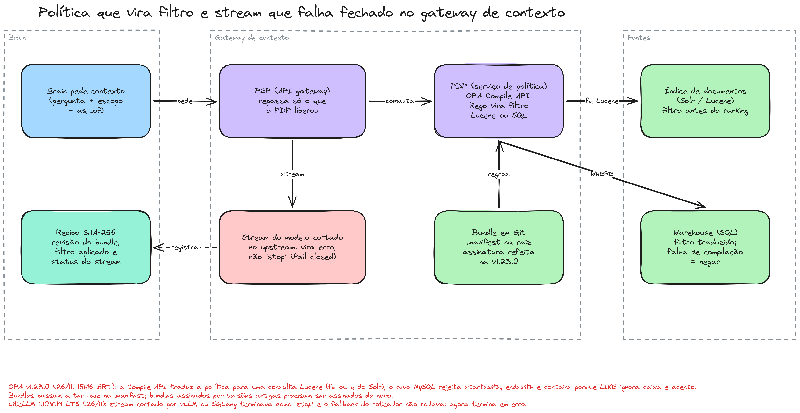

# Digest — IA, ML e dados · 27 nov 2026 (sexta)

## O que prestar atenção hoje

- No Gateway de contexto, a mesma política que decide o acesso agora pode virar o filtro da busca. O OPA v1.23.0 (26/11, 15h16 BRT) traz um alvo Lucene (Solr) para a Compile API: a regra em Rego com o documento como incógnita compila para um `fq` do Solr. O alvo MySQL passa a rejeitar `startswith`, `endswith` e `contains`, porque o `LIKE` ignorava caixa e acento e deixava passar mais do que a regra dizia. E há uma quebra: o bundle passa a ter raiz no `.manifest`, então bundles assinados por versões anteriores precisam ser assinados de novo.
- Fail closed também vale para streaming. No LiteLLM 1.108.19 LTS (26/11, 16h05 BRT), um stream que o vLLM ou o SGLang cortava no meio chegava ao app como `stop` normal: a resposta pela metade ficava como completa e o fallback do roteador nunca rodava. Agora o stream termina com erro (`finish_reason=abort` vira `MidStreamFallbackError`). A mesma LTS corrige chamadas de agente cobradas a 0 ou ao preço de outro agente.
- Em RAG e retrieval e Memória de agentes, guardar as duas versões de um fato não basta. No arXiv 2611.34762, 53% das respostas sobre fatos revisados afirmam o valor antigo quando as duas versões estão na memória, e o modelo volta ao fato dos pesos em até 46% das consultas mesmo com a memória certa no prompt. No 2611.33250, o embedding base prefere a quase-cópia com um fato alterado em 99,58% dos casos. Escolher a versão vigente pelo `as_of` é trabalho do retriever, não do modelo.

## 1. OPA v1.23.0: política que compila para filtro Lucene e bundle com raiz fixa (26/11)

- **O que é.** Release do Open Policy Agent publicada em 26/11, às 15h16 BRT. Os pontos que mexem no desenho: o alvo Lucene (Solr) na Compile API, o endurecimento do alvo MySQL, a raiz do bundle no `.manifest` (mudança que quebra compatibilidade), os bundles gerados e um indexador de regras mais amplo.
- **Como funciona.** Com `Accept: application/vnd.opa.lucene.solr+json`, a Compile API traduz uma política cuja incógnita é o documento (`input.doc`) para uma consulta Lucene. O exemplo da release (dono igual ao usuário, nível ≥ 3, status diferente de rascunho) vira `(owner:"alice" AND level:[3 TO *] AND NOT status:"draft")`. Campos multivalorados são comparados por elemento, e o `solr_schema.rego` gera as anotações de schema a partir da Schema API do Solr. Esse alvo não entra em pedido multitarget. No alvo MySQL, `startswith`, `endswith` e `contains` agora fazem a compilação falhar: viravam `LIKE`, que nas collations padrão ignora caixa e acento, e `startswith(name, "APP")` casava `apple`. No bundle, o diretório do `.manifest` vira a raiz, os nomes em `.signatures.json` ficam relativos a ela, e bundles assinados com `opa sign` ou `opa build -b` de versões antigas precisam ser assinados de novo. Bundles baixados por HTTP ou OCI ainda carregam, com aviso, e vão falhar numa versão futura. Bundle marcado `"generated": true` é parseado sem localização de fonte: num benchmark de 20.000 regras geradas, a memória das políticas compiladas caiu 40%. O índice de regras passa a cobrir pertencimento a coleções, o que tirou de 40% a 55% da avaliação em benchmarks de 500 regras condicionadas a grupo. No main, a tradução de expressões lógicas do Rego v2 para filtros entrou em 27/11 (04h34 BRT).
- **Para quem monta um gateway de contexto.** Uma política só no bundle em Git passa a servir à decisão e ao filtro. O PDP chama a Compile API com o chamador e o escopo do brain como conhecidos e o documento como incógnita, e o filtro gerado entra no retriever antes do ranking. Assim, o modelo nunca vê o que a regra excluiria. A Busca híbrida aplica o mesmo filtro ao BM25 e ao vetor. Se a compilação falha, inclusive por um operador que o alvo rejeita, a consulta é negada (fail closed), nunca enviada sem filtro. A lição do MySQL vale para qualquer tradução de política para SQL do warehouse: conferir a collation antes de confiar em casamento de texto. No CI, o aviso de bundle com `.manifest` fora da raiz deve ser tratado como erro, e o recibo SHA-256 registra a `revision` do manifest, o hash do bundle e o filtro efetivamente aplicado.
- **Na comunidade:** no X (27/11, 5 curtidas e 2 reposts), @_avichawla observa que Google e Anthropic tiraram o retrieval do app e o transformaram num serviço que o agente invoca. É o ponto em que um filtro compilado a partir da política faz sentido: https://x.com/_avichawla/status/2126230926518890644
- Fontes: https://github.com/open-policy-agent/opa/releases/tag/v1.23.0 · https://www.openpolicyagent.org/docs/filtering/lucene

## 2. Stream cortado que parecia completo: LiteLLM 1.108.19 LTS e orçamento por minuto no MLflow (26/11)

- **O que é.** Duas LTS do LiteLLM saíram em 26/11, a 1.108.18 (14h06 BRT) e a 1.108.19 (16h05 BRT). A 1.108.19 traz 19 PRs, 13 deles correções. A que interessa ao desenho é o backport do PR 54466 (mergeado às 02h48 BRT), que trata o corte de stream no upstream.
- **Como funciona.** Na linha 1.108, quando um servidor vLLM ou SGLang auto-hospedado cortava uma resposta em streaming, as rotas `openai`, `hosted_vllm`, `azure_ai`, `databricks`, Vertex Model Garden e `/v1/completions` (e também `openrouter`, `snowflake`, `ragflow`, `cometapi` e `amazon_nova`) devolviam um término normal. O app ficava com a resposta pela metade e o fallback do roteador não rodava. Agora toda rota termina com um 500 "Upstream generation aborted (finish_reason=abort)" no meio do stream, que vira `MidStreamFallbackError` e evento de erro SSE. Os mantenedores descartaram repassar o `abort`, porque clientes OpenAI não conhecem esse valor e tratam a resposta como pronta. O stream síncrono que falha passa a registrar os tokens já enviados. A mesma LTS corrige chamadas a agente com preço por consulta cobradas a 0 ou ao preço de outro agente no mesmo modelo (PR 54584), e gauges de rate limit do Prometheus que não contavam `/v1/messages` em streaming. No MLflow, o PR 28106 (26/11, 03h39 BRT) expõe na interface do AI Gateway os períodos de orçamento em minutos e horas. Antes, editar uma política de 6 horas criada pela API a salvava como mensal.
- **Para quem monta um gateway de contexto.** Fim de stream sem `finish_reason` válido é falha, não resposta: o PEP não deve fechar a resposta como completa, o recibo SHA-256 registra o hash do texto efetivamente entregue junto com o status de término, e resposta parcial não entra no cache semântico. Se o roteador tem fallback, ele precisa ver o erro; um `stop` falso desliga o fallback sem ninguém perceber. Para o FinOps de tokens, o custo no recibo deve ser conciliado com o preço por agente, e as métricas de rate limit conferidas também para o tráfego em streaming. Orçamento com reset curto (minutos ou horas) serve como disjuntor por brain.
- Fontes: https://github.com/BerriAI/litellm/releases/tag/v1.108.19 · https://github.com/BerriAI/litellm/pull/54466 · https://github.com/BerriAI/litellm/pull/54584 · https://github.com/mlflow/mlflow/pull/28106

## 3. MCP passa a ter release semestral: próxima especificação em 30/03/2027, não mais em dezembro (26/11)

- **O que é.** O PR 3550 do repositório da especificação do MCP (mergeado em 26/11, 17h04 BRT) publica a página de ciclo de release exigida pela SEP-3398 e ajusta a governança. O roadmap passa a dizer que a próxima versão da especificação sai em 30/03/2027, no lugar da meta anterior de dezembro de 2026, e que esta é a primeira release do ciclo semestral.
- **Como funciona.** As versões da especificação saem a cada seis meses, em geral na última terça-feira de março e de setembro, com ciclos de oito meses que se sobrepõem por dois. A data da release é o número da versão (AAAA-MM-DD). Os marcos: a revisão dos Core Maintainers abre seis meses antes; no soft freeze, 2,5 meses antes, o escopo fica fixo e só entram SEPs Final e mergeadas; os SDKs Tier 1 publicam betas 1,5 mês antes; no hard freeze, um mês antes, só entram correções críticas. A aceitação de uma SEP passa a ser uma votação registrada de sete dias, com mais da metade dos Core Maintainers a favor, e a SEP que não atinge nenhum dos dois limiares volta a `draft`. O grupo de Core Maintainers também pode patrocinar SEPs. A release de 30/03/2027 já tem gerentes de release nomeados.
- **Para quem monta um gateway de contexto.** O gateway negocia e fixa a versão do protocolo por servidor, e agora dá para planejar: a próxima versão só chega no fim de março, as betas dos SDKs Tier 1 cerca de 1,5 mês antes, e o escopo fecha em meados de janeiro. Até lá, recursos que vêm como extensão (Skills, por exemplo) evoluem fora do núcleo, e a allowlist do PDP deve registrar a versão do protocolo e as extensões aceitas por servidor. O recibo SHA-256 guarda a versão negociada.
- **Na comunidade:** no r/mcp (26/11, 26 pontos e 26 comentários), a thread "MCP is 2 years old. Are we still mostly using it for basic tool calling?" chega ao mesmo diagnóstico por outro lado. Para u/Independent-Sir3234, o suporte desigual entre clientes mantém a maioria dos servidores em produção em tool calls simples, porque um servidor que precisa funcionar em Claude Code, Cursor, Codex e web não pode depender de elicitation ou de eventos push. Para brains só de leitura, isso reforça tools simples e tipadas atrás do gateway: https://www.reddit.com/r/mcp/comments/1y67d2h/mcp_is_2_years_old_are_we_still_mostly_using_it/
- Fontes: https://github.com/modelcontextprotocol/modelcontextprotocol/pull/3550 · https://modelcontextprotocol.io/community/release-cycle · https://modelcontextprotocol.io/development/roadmap · https://modelcontextprotocol.io/seps/3398-release-cycle-updates

## 4. A versão vigente é trabalho do retriever: memória que confunde revisões e embeddings que não veem o fato (arXiv 2611.34762, 2611.33250, 2611.33184 e 2611.33791)

- **Alucinação no uso da memória (25/11).** Em cinco modelos abertos, a memória certa é recuperada e posta no prompt, e mesmo assim a resposta a contradiz. Os autores separam três formas: ignorar a memória e voltar ao fato dos pesos (até 46% das consultas), aplicar a memória à entidade errada (até 24%, e 49% quando o retrieval é combinado com edição de pesos) e confundir versões (53% das respostas sobre fatos revisados afirmam o valor superado quando as duas versões estão guardadas). A TASK memory combina nota de texto, edição de conhecimento removível e vetores de steering que decidem, consulta a consulta, se o modelo adota a memória. Em modelos congelados, com protocolo pré-registrado, ela reduz o "ignorar a memória" a no máximo 1,5% nas dez combinações de modelo e dataset, corta o uso indevido em vizinhos de 39,2% para 7,5% e ganha 16,4 pontos sobre RAG com BM25 numa biblioteca de 300 memórias, vantagem que se mantém com 3.000.
- **Embedding que confunde estilo com fato (24/11).** No FOF-Bench (83.263 trios em cinco domínios), o modelo base escolhe a quase-cópia com um fato corrompido, contra a reescrita que preserva o fato, em 99,58% dos casos. Depois do ajuste com negativos difíceis, o FOF-80M chega a 29,37% de preferência pelo fato. Os autores o tratam como impressão digital factual, não como métrica de factualidade.
- **Densidade não avisa o colapso (arXiv 2611.33184).** Em 805 snapshots de 13 métodos de memória, nenhuma estatística de geometria, retrieval ou grafo previu de forma confiável a queda de acurácia. Classificadores treinados nesse corpus marcaram como falsos alarmes 56,9% dos checkpoints estáveis e detectaram só 18% dos checkpoints depois do colapso. A única falha veio do prompt com a memória inteira, sem limite, estourando a entrada do modelo, algo que o crescimento de tokens já previa.
- **Extração de documentos (25/11).** No ExtractBench Pro (100 documentos sintéticos, dez agentes de código e oito configurações de APIs de extração), nenhum sistema extrai mais de 61% dos documentos sem erro. Os agentes de código mais fortes superam as APIs especializadas em taxa de documento perfeito e em Value F1, com custo por página maior.
- **Para quem monta brains analíticos.** Um fato revisado (taxa, norma, limite, cadastro) é guardado com intervalo de vigência, e o retriever filtra pelo `as_of` da pergunta antes de o modelo ver o texto. Pôr as duas versões no prompt e esperar que o modelo escolha erra na maioria das vezes. Busca só densa não separa versões que diferem num número ou numa data: na busca híbrida, o lado lexical e os metadados estruturados (vigência, versão do documento) fazem esse trabalho, e o reranker precisa ser avaliado em pares quase iguais com o fato trocado. Na memória, o sinal útil é o tamanho, não a densidade semântica: limite de itens e de tokens por brain, com alarme. Campo extraído de PDF entra no brain com validação por campo e citação do trecho de origem.
- Fontes: https://arxiv.org/abs/2611.34762 · https://arxiv.org/abs/2611.33250 · https://arxiv.org/abs/2611.33184 · https://arxiv.org/abs/2611.33791

## 5. Roteamento sem calibração, rotas longas e verificação com certificado (arXiv 2611.34112, 2611.33242 e 2611.34132)

- **Revisão sistemática (25/11).** Juntando 2.289 estudos (de 13.884 registros, de 2017 a setembro de 2026) sobre gating de experts, cascatas de modelos e orquestração de agentes num esquema "inspecionar e depois alocar", a seleção discreta domina: 70%, 83% e 91% da literatura nas escalas de token, consulta e tarefa. Nas camadas de seleção de modelo e de orquestração, as salvaguardas são limiares de confiança e regras de orçamento, que esbarram em má calibração e em erros em cascata. A delegação entre agentes é a área em que as publicações mais crescem e em que o mecanismo de roteamento é menos isolado em experimento.
- **CypherMAS (24/11).** Benchmark sintético que isola comunicação e roteamento em grafos fixos de agentes (cadeia, estrela, bipartido, anel), com a rota ótima conhecida. Em onze modelos abertos de 4B a 753B, os pequenos falham em roteamento e uso de tools, os densos acima de 27B degradam com o diâmetro do grafo, e mesmo as execuções bem-sucedidas fazem mais chamadas de LLM que o mínimo.
- **Agent-as-a-Verifier (25/11).** Verificador agêntico que produz um certificado: extrai, sem ver o veredito, um grafo de dependência das afirmações da resposta, compila à parte o contrato de aceitação da tarefa e deriva obrigações checáveis. Supera o estado da arte no Terminal-Bench 2.1 e identifica soluções que enganam o avaliador do benchmark.
- **Para quem monta um gateway de contexto.** O modelo de decisão que escolhe a fonte precisa de confiança calibrada e de um experimento que isole a decisão de rota, medida contra a rota ótima conhecida num conjunto rotulado. Sem isso, o limiar de abstenção é palpite. O CypherMAS sustenta manter a rota curta (brain → gateway → fonte) em vez de cadeias de agentes. Já o certificado do verificador tem a forma do recibo: afirmações da resposta, obrigações (métrica citada, `as_of`, fonte, escopo) e o resultado de cada checagem, com hash SHA-256, antes de liberar a resposta.
- Fontes: https://arxiv.org/abs/2611.34112 · https://arxiv.org/abs/2611.33242 · https://arxiv.org/abs/2611.34132

## 6. Orquestração: listener depois do commit, trigger Kafka compartilhado, provider Polaris e o dbt que falha calado (26–27/11)

- **Listeners de asset depois do commit (Airflow, main, 27/11, 06h34 BRT).** Na Orquestração de dados, o PR 77024 faz `Trigger.submit_event` commitar antes de chamar os listeners de asset (`on_asset_changed`, `on_asset_event_emitted`), como o caminho de task já fazia. Antes, eles rodavam dentro da transação do triggerer, antes de as DAG runs entrarem na fila. Um listener que travasse (um webhook pendurado) por mais que o `idle_in_transaction_session_timeout` do Postgres fazia o commit falhar e derrubava o triggerer. Com um watcher de stream compartilhado, o broker reentregava o evento e o triggerer entrava em loop de crash. E mesmo sem crash, os listeners já tinham reportado eventos que depois sofriam rollback, o que o listener do OpenLineage em desenvolvimento reportaria como linhagem.
- **Kafka para watchers movimentados (main, 26/11, 23h52 BRT).** A documentação do provider Kafka passa a recomendar o `KafkaSharedStreamTrigger` (Airflow 3.3+): o `KafkaMessageQueueTrigger` abre um consumer novo a cada início, e com tópicos movimentados ou muitos watchers de asset isso gera rebalances e, num caso relatado, um `close()` travado que congelou o triggerer.
- **Provider Apache Polaris (main, 26/11, 16h06 BRT).** Novo provider em incubação para o catálogo Iceberg aberto: conexão com OAuth interno, OIDC externo ou bearer (com mascaramento de todo token obtido), hooks de gestão e de catálogo, operadores idempotentes para catálogos, namespaces, tabelas, papéis, grants e políticas, e um helper que transforma políticas de manutenção de tabela do Polaris em procedures Spark do Iceberg. Requer Airflow 3.1.1 ou mais novo.
- **dbt e Cosmos (26/11).** No Cosmos, o PR 3173 (08h55 BRT) corrige um sucesso falso: quando `packages-install-path` usava `env_var()` definida só em `ProjectConfig.env_vars`, o `dbt deps` falhava, a falha era ignorada, o comando dbt rodava contra os pacotes antigos e a task terminava com sucesso. Agora `dbt deps` com falha derruba a task, independentemente de `skip_exit_code`. Na documentação do dbt (13h20 BRT), o dbt v2 passa a ter canais `stable`, `preview` e `nightly`, e `dbt system update` sem versão instala o `stable` mais recente.
- **Para quem migra a orquestração.** Ao trocar uma malha de `ExternalTaskSensor` por assets, o listener deixa de ser só observabilidade e passa a estar no caminho crítico do triggerer, e o PR 77024 ainda está no main, fora das versões do Airflow oferecidas no Cloud Composer Gen 3 (hoje até a 3.3.1). Até ele chegar: listeners sem I/O bloqueante, envio em thread de fundo, e o `idle_in_transaction_session_timeout` conhecido. Se o gatilho de dado vier de fila, o trigger compartilhado é o padrão. Com dbt orquestrado pelo Cosmos, o caso do PR 3173 mostra por que o `dbt deps` precisa falhar alto e a versão do dbt precisa estar fixada na imagem: um canal `stable` que se move torna o backfill irreprodutível. Em brains com `as_of`, só evento de asset commitado deve avançar a data de referência; evento revertido que chega ao listener é dado que não existe.
- Fontes: https://github.com/apache/airflow/pull/77024 · https://github.com/apache/airflow/pull/77632 · https://github.com/apache/airflow/pull/77188 · https://github.com/astronomer/astronomer-cosmos/pull/3173 · https://github.com/dbt-labs/docs.getdbt.com/pull/10427 · https://docs.getdbt.com/reference/commands/system

## 7. Crédito: evidência com procedência e momento, e alarme de shift sem rótulo (arXiv 2611.34696 e 2611.34767, 25/11)

- **Underwriting fragmentado (25/11).** Os autores descrevem três falhas na análise de credenciamento de lojistas. A primeira é a distância da fonte: a decisão fica longe da evidência que a justificaria. A segunda é a lacuna de correlação: relações entre pessoa, entidade legal, sócios ou controladores, representante, atividade e destino da liquidação não são avaliadas quando cada sinal é checado sozinho. A terceira são os controles pontuais, quando uma verificação histórica é tratada como elegibilidade presente. A proposta é um registro de evidência logicamente unificado (o que foi checado, sujeito e relação, tempos, política aplicável, decisão e exceções) e um recibo de evidência e decisão. O piloto em sombra de 90 dias e os controles são apresentados como propostas, sem resultado de produção.
- **CALD (25/11).** Monitor não supervisionado que dispara alarme quando um modelo tabular pré-treinado (TabPFN, TabICL) pode estar falhando sob shift de distribuição, sem rótulos no lote de teste. Em 14 datasets, empata com ou supera os baselines em shift nocivo e dá menos falso alarme em shift benigno.
- **Para modelos de risco de crédito.** As três falhas mapeiam direto para features de crédito a empresas: o mesmo CNPJ visto por sinais separados (sócios, representante, conta de liquidação) sem a correlação entre eles, e verificação cadastral antiga usada como se fosse atual. Toda feature cadastral carrega data de verificação e vigência, e o split respeita o `as_of`. O formato do recibo (o que foi checado, quando, sob qual política, com qual decisão) é o mesmo do recibo SHA-256 do gateway. Como o rótulo de default chega meses depois, um monitor de shift sem rótulo como o CALD é o alarme possível no intervalo, quando o modelo é tabular pré-treinado.
- Fontes: https://arxiv.org/abs/2611.34696 · https://arxiv.org/abs/2611.34767

## Diagrama

Política que vira filtro no gateway de contexto: o PEP repassa só o que o PDP liberou; o PDP compila a regra do bundle em Git (raiz no `.manifest`, assinatura refeita na v1.23.0) para um filtro Lucene no índice de documentos ou para um `WHERE` no warehouse, e falha de compilação é negação. O stream do modelo cortado no upstream vira erro, não `stop`, e o recibo SHA-256 registra a revisão do bundle, o filtro aplicado e o status do stream. Editável: [2026-11-27-politica-vira-filtro.excalidraw](../../assets/2026-11-27-politica-vira-filtro.excalidraw).

## Repos em alta

- **es-ine/mcp** (EUPL-1.2, criado em 26/11/2026, 177 stars pela API do GitHub em 27/11): servidor MCP para a API JSON pública do INE, o instituto de estatística da Espanha, com cinco tools só de leitura (operação → tabelas → variáveis → valores → dados). A ordem é verificada em código e não pode ser desligada: uma chamada adiantada devolve um erro que começa com `BLOCKED`, diz qual passo falta e qual chamar em seguida, e o servidor rejeita identificadores que ele mesmo não devolveu (tabela não listada no passo 2, filtro com valor que não veio do passo 4). Cada resultado traz a operação, a tabela, a URL pública e os filtros aplicados. Para brains analíticos, é o padrão certo para dados oficiais: o modelo não inventa código de tabela ou filtro porque o servidor só aceita o que já mostrou, e a citação vem do programa, não do LLM: https://github.com/es-ine/mcp
- **XiaoMi/os-memory** (Apache-2.0, criado em 25/11/2026, 25 stars pela API do GitHub em 27/11): memória pessoal para agentes no dispositivo, em biblioteca Python e servidor MCP, que transforma registros fragmentados entre apps (SMS, notificações, agenda, telas) num grafo de eventos rastreável em cinco camadas, do registro bruto à memória de longo prazo. O caminho rápido (DRED) atribui cada observação a um evento por identificador, entidade e similaridade, só com embedding; o lento (SAGE) usa LLM para consolidar fronteiras, resumir, extrair fatos e induzir memórias longas. A documentação lista o que sai para a rede em cada operação e trata a deleção por arquivo. Para a memória de brains analíticos, vale a rastreabilidade de cada fato até o registro bruto e a separação explícita entre o que roda local e o que vai para o modelo, que é o desenho que a LGPD pede: https://github.com/XiaoMi/os-memory
- **yb-zhai/agent-memory** (MIT, criado em 21/11/2026, 62 stars pela API do GitHub em 27/11): o Nebula Memory, memória de agente local e sem dependências, com recall em quatro braços (lexical, ativação, difusão em grafo e perfil) fundidos por RRF, painel de visualização e servidor MCP; a camada semântica via API externa é opcional. Para a busca híbrida, é um exemplo compacto de fusão de sinais heterogêneos por RRF sem banco nem LLM no caminho do recall: https://github.com/yb-zhai/agent-memory

## Para aprofundar

- Cache em OLAP na nuvem com acesso direto ao object store (arXiv 2611.33977): 22 algoritmos de substituição e um baseline de cache semântico, em sete cargas analíticas e dez tamanhos de cache, comparados pela Unified Hit Ratio, um hit ratio ponderado por latência. Políticas clássicas sensíveis a tamanho seguem fortes, filtrar objetos sem reuso define a eficiência em bytes, e sob deriva multi-tenant a adaptação leve por requisição é mais robusta que métodos aprendidos: https://arxiv.org/abs/2611.33977
- Deleção verificável em LLM (arXiv 2611.33525): um score de inferência de pertencimento perto do acaso só prova esquecimento se a população de referência representar o modelo depois de uma deleção válida. No BookMIA, o retreino exato fica a 0,122 do acaso, e no eixo ArxivMIA/Llama nenhuma configuração testada de GA+GD, NPO-RT ou SCRUB passa. Interessa ao direito de eliminação da LGPD em modelos ajustados: https://arxiv.org/abs/2611.33525
- Agent Experience (arXiv 2611.33480): instrumento que pontua transcrições de sessões agênticas em clareza, acionabilidade, fidelidade e eficiência. Em 882 sessões avaliadas, a acionabilidade teve as piores notas (59,6% das notas ≤ 3, contra 26,6% em fidelidade), e defeitos de contexto injetados aumentaram o consumo de tokens em 91% na média: https://arxiv.org/abs/2611.33480
- AgentLens (arXiv 2611.34380): auditoria de segurança de agentes guiada por um grafo de conhecimento de auditoria, que deriva caminhos de ataque e os valida em cenários multi-turno; em cinco aplicações de agentes com mais de 24 mil stars cada, achou 44 vulnerabilidades, todas disparadas em execução: https://arxiv.org/abs/2611.34380
- Registros compartilhados assinados para coordenação agente-empresa (arXiv 2611.33373): registros assinados do AT Protocol com execução de tarefas A2A, num estudo de desenho; o protocolo cobre cinco de seis requisitos de coordenação, e o controle de acesso e de liberação por registro exige enforcement adicional: https://arxiv.org/abs/2611.33373
